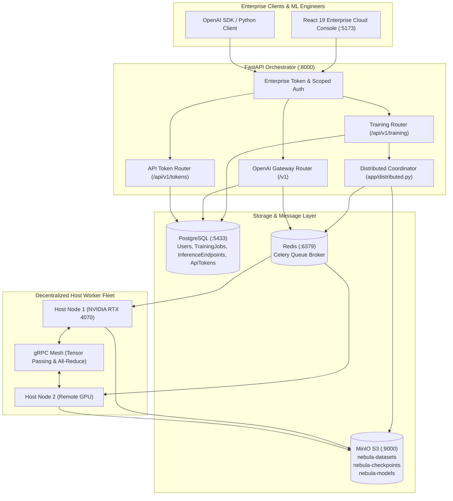
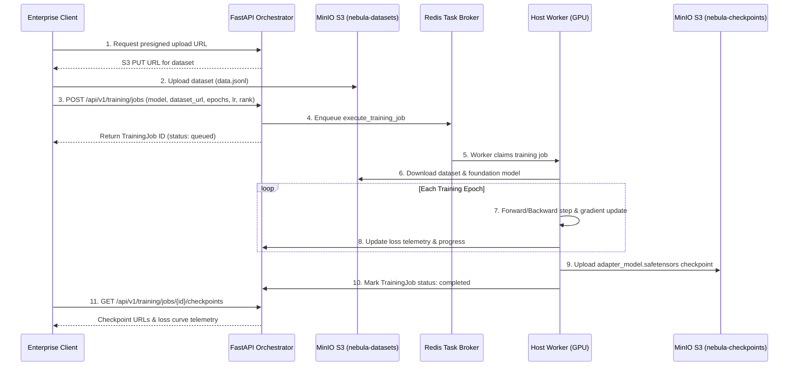
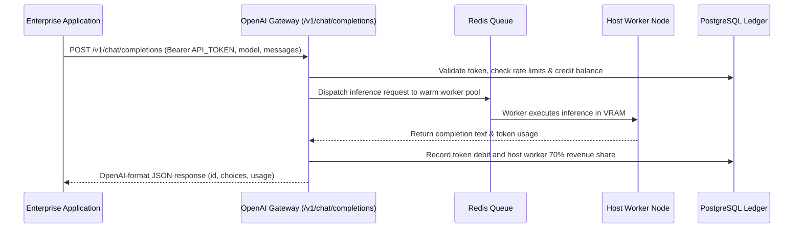

# Project NetworkNebula — Enterprise Technical Architecture

This document defines the high-level and component architecture for the **Enterprise B2B Decentralized AI Compute Network**.

---

## 1. System Architecture



---

## 2. Core Data Flows

### A. Enterprise Model Training Lifecycle



### B. Enterprise Model Serving Lifecycle (OpenAI-Compatible Gateway)



---

## 3. Storage Hierarchy (MinIO S3)

All object storage buckets are partitioned by organization ID to ensure strict enterprise data isolation:

```text
nebula-datasets/
  └── {org_id}/
      └── {dataset_id}/
          ├── data.jsonl
          └── metadata.json

nebula-checkpoints/
  └── {training_job_id}/
      ├── epoch_1/
      │   ├── adapter_config.json
      │   └── adapter_model.safetensors
      ├── epoch_final/
      │   ├── adapter_config.json
      │   └── adapter_model.safetensors
      └── loss_history.json

nebula-models/
  └── {base_model_id}/
      └── weights/
```

---

## 4. Multi-Tenancy Database Entities

| Entity | Primary Table | Purpose |
| :--- | :--- | :--- |
| **`User`** | `users` | Account profile, role (`creator`/`worker`), base credits |
| **`TrainingJob`** | `training_jobs` | Fine-tuning run, base model, dataset S3 URL, loss history, checkpoints |
| **`InferenceEndpoint`** | `inference_endpoints` | Deployed model endpoint, model ID, adapter URL, status, latency metrics |
| **`ApiToken`** | `api_tokens` | Enterprise scoped API tokens with RPM/TPM rate limits and expiration |
| **`Transaction`** | `transactions` | Immutable financial ledger auditing credits, debits, and worker payouts |
| **`Worker`** | `workers` | Decentralized host GPU hardware specs, online status, tasks completed |

---

## 5. Worker Distributed Ring All-Reduce Protocol

When multiple decentralized host workers are assigned to a distributed training job:
1. Workers form a **`WorkerGroup`** identified by group ID.
2. In data-parallel training, each worker computes local gradients for its batch shard.
3. The **`GradientAggregator`** in `app/distributed.py` collects bucket gradients from each worker.
4. Once all worker gradients for a layer bucket arrive, all-reduce computes the mean gradient tensor.
5. The aggregated gradient is broadcast back to all worker nodes via gRPC streaming (`app/grpc_endpoints.py`), ensuring weights remain synchronized across nodes without a central bottleneck.
