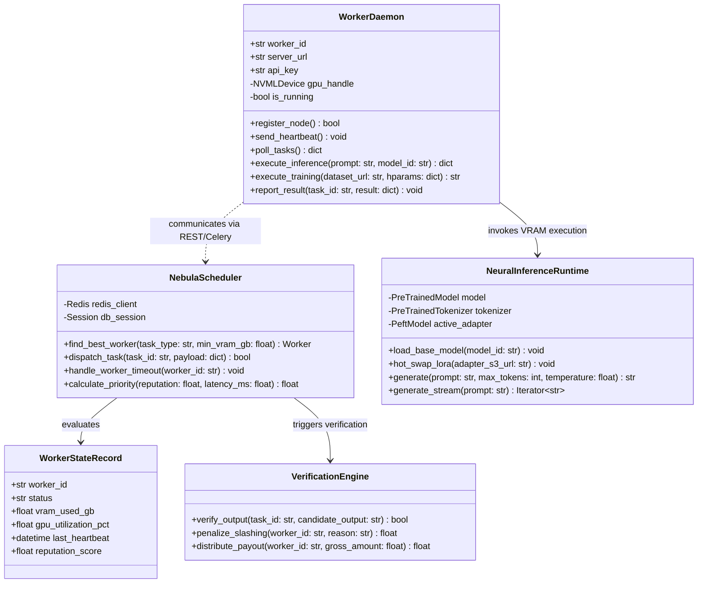
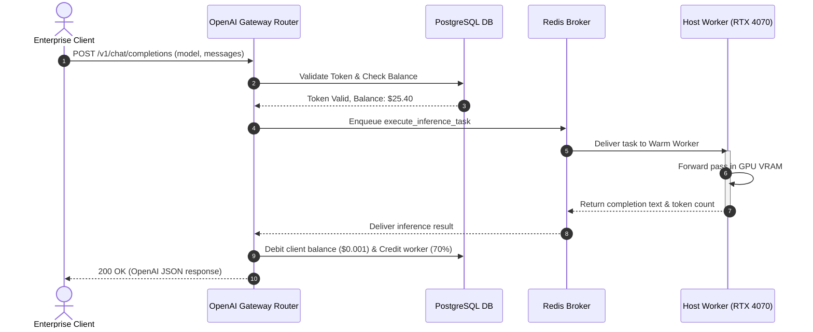
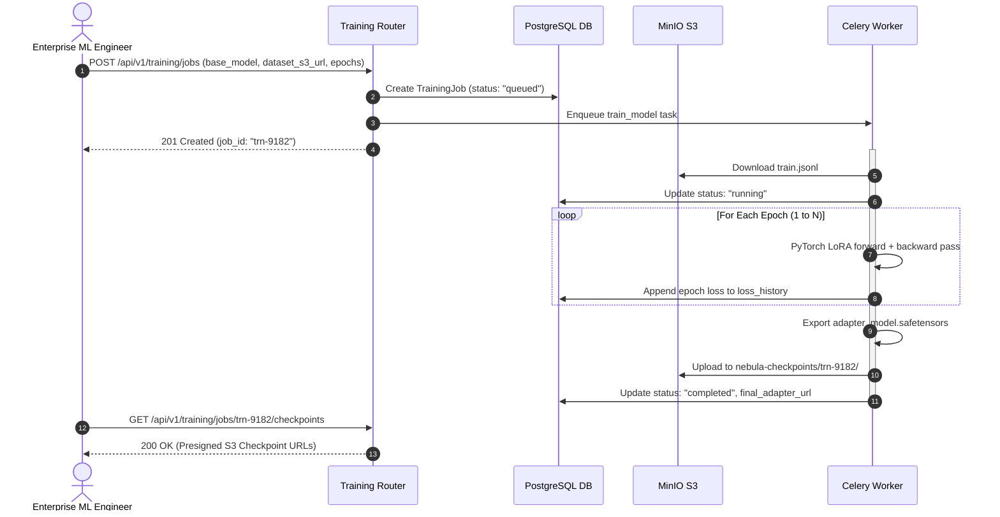
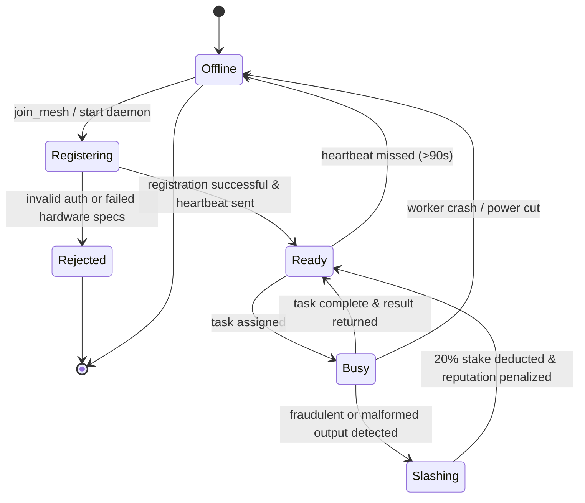
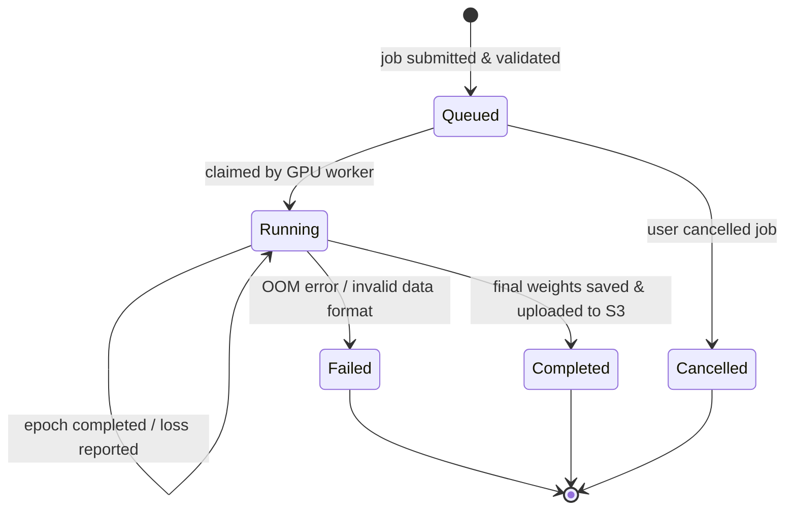

# Engineering Design Document (EDD): Project NetworkNebula
## Component Focus: Distributed Compute Orchestration & Worker Engine

> **Course:** Intro2SE (Software Engineering) · School of Computer Science, Ariel University  
> **Course Lecturer:** Prof. Boaz Ben-Moshe  
> **Document Code:** EDD-NN-2026-v1.0  
> **Component Target:** `app/worker.py`, `app/scheduler.py`, `app/cluster_worker_router.py`, `nebula_worker.py`  
> **Traceability Reference:** Details [SDD §2 Component 3 & 5](file:///c:/Users/ohadb/Desktop/ALL/APPS/Project%20NetworkNebula/docs/SDD.md) and implements [SRS REQ-06 through REQ-19](file:///c:/Users/ohadb/Desktop/ALL/APPS/Project%20NetworkNebula/docs/SRS.md)  
> **Target Audience:** Implementers, Code Reviewers, Systems Software Engineers  
> **Document Purpose:** Detail *how* the compute orchestration and worker execution engine is built, its internal classes, algorithms, sequence flows, state machine, and error handling.

---

## 1. Module & Class Design

The engine coordinates decentralized compute between the central Celery task queue, the FastAPI scheduler, and autonomous GPU workers.

### 1.1 Detailed UML Class Diagram



---

## 2. Algorithms & Data Structures

### 2.1 Worker Selection & Priority Dispatch Algorithm
To maximize cluster throughput and minimize latency, the scheduler scores candidate workers using a multi-factor weighting formula:

$$\text{Score}(W) = 0.40 \cdot \frac{\text{Reputation}(W)}{100} + 0.30 \cdot \left(1 - \frac{\text{VRAM}_{\text{used}}}{\text{VRAM}_{\text{total}}}\right) + 0.20 \cdot \frac{100}{\text{Latency}_{\text{ms}}} + 0.10 \cdot \frac{\text{Stake}(W)}{\text{MinStake}}$$

#### Selection Steps:
1. **Filtering:** Query `workers` table where `status == "ready"` AND `gpu_memory_gb >= required_vram` AND `is_available == True`.
2. **Scoring:** Compute $\text{Score}(W)$ for all active candidates in memory.
3. **Dispatch:** Select worker $W^*$ with $\max(\text{Score})$. Enqueue task to worker's dedicated Celery routing key `worker.{W*.id}`.
4. **Optimistic Locking:** Update `Worker.status = "busy"` and set Redis lock `lock:worker:{id}` with a 60-second TTL.

### 2.2 Dynamic LoRA Adapter Hot-Swapping Algorithm
Workers preserve foundation model weights in VRAM (e.g., Qwen-2.5-0.5B or Llama-3.2-1B) and hot-swap lightweight LoRA adapter tensors dynamically without unloading the base model:

```python
def hot_swap_lora(self, adapter_s3_url: str):
    adapter_hash = hashlib.sha256(adapter_s3_url.encode()).hexdigest()
    local_path = f"/models/cache/adapters/{adapter_hash}"
    
    if not os.path.exists(local_path):
        self.s3_client.download_file("nebula-checkpoints", adapter_s3_url, local_path)
        
    if self.active_adapter_id != adapter_hash:
        # Detach previous adapter and mount new safetensors in VRAM
        self.model.set_adapter(adapter_hash)
        self.active_adapter_id = adapter_hash
```

---

## 3. Database Schema & Wire Data Formats

### 3.1 Pydantic Request / Response Data Contracts

```python
class ChatMessage(BaseModel):
    role: str  # "system", "user", "assistant"
    content: str

class ChatCompletionRequest(BaseModel):
    model: str
    messages: List[ChatMessage]
    temperature: Optional[float] = 0.7
    max_tokens: Optional[int] = 512
    stream: Optional[bool] = False

class ChatCompletionChoice(BaseModel):
    index: int
    message: ChatMessage
    finish_reason: str = "stop"

class UsageInfo(BaseModel):
    prompt_tokens: int
    completion_tokens: int
    total_tokens: int

class ChatCompletionResponse(BaseModel):
    id: str
    object: str = "chat.completion"
    created: int
    model: str
    choices: List[ChatCompletionChoice]
    usage: UsageInfo
```

---

## 4. Key Execution Flows: UML Sequence Diagrams

### 4.1 Inference Request Lifecycle (`POST /v1/chat/completions`)



---

### 4.2 Training Job Execution & S3 Checkpoint Creation



---

## 5. State Machine: Host Worker & Task Lifecycles

### 5.1 Host Worker Lifecycle



### 5.2 Training Task State Machine



---

## 6. Error Handling & Edge Cases

| Failure Scenario | Detection Mechanism | System Action & Recovery | User/Client Impact |
| :--- | :--- | :--- | :--- |
| **Worker OOM (Out of Memory)** | PyTorch `torch.cuda.OutOfMemoryError` caught in worker loop. | Worker clears VRAM cache via `torch.cuda.empty_cache()`, reports failure to orchestrator, and re-registers with smaller batch size. | Task is automatically re-routed to a higher-VRAM worker (e.g., 16 GB node). |
| **Worker Drops Mid-Job** | Celery worker visibility timeout fires or heartbeat misses $>90\text{ s}$. | Orchestrator marks worker `offline`, resets task state from `PROCESSING` to `QUEUED`, and re-dispatches to another active node. | Slight latency delay ($\approx 3\text{ s}$); zero data loss. |
| **Malformed JSONL Dataset** | Pydantic validation fails during S3 parsing stream. | Job marked `failed`; detailed line-number parsing error written to `TrainingJob.loss_history`. | Client receives descriptive HTTP 400 error detailing faulty line. |
| **Malicious Output / Poisoning** | Verification Engine spots divergence from consensus or gradient explosion. | Worker stake slashed by 20%; worker reputation reduced to 0; task recomputed. | End client receives verified, safe output. |

---

## 7. Performance Budget & Resource Allocations

To guarantee low latency and prevent resource starvation on worker nodes:

| Metric | Target Budget | Upper Bound Limit | Enforcement Mechanism |
| :--- | :--- | :--- | :--- |
| **Time-to-First-Token (TTFT)** | $250\text{ ms}$ | $600\text{ ms}$ | Pre-warmed base weights held in GPU VRAM |
| **Streaming Throughput** | $45\text{ tokens/sec}$ | $20\text{ tokens/sec (min)}$ | FP16/INT4 quantization |
| **Worker VRAM Allocation** | $80\%$ of physical VRAM | $90\%$ of physical VRAM | `torch.cuda.set_per_process_memory_fraction(0.80)` |
| **Gateway Proxy Overhead** | $\le 15\text{ ms}$ | $35\text{ ms}$ | Fast asynchronous uvloop & Redis connection pools |
| **Heartbeat Network Footprint** | $1.2\text{ KB/min}$ | $5.0\text{ KB/min}$ | Compact JSON payloads over persistent TCP |

---

## 8. Rollout, Migration & Testing Plan

1. **Unit Testing:** Individual verification of worker scoring equations, token calculation, and Pydantic validators.
2. **Integration Testing:** Dockerized end-to-end verification linking FastAPI, Redis broker, Celery worker, and MinIO S3.
3. **Hardware Simulation Test:** Automated tests in `test_suite.py` mocking CUDA memory allocations and verifying graceful fallback to CPU simulation when GPUs are absent.
4. **Live Online Cutover:**
   - Boot database container and apply Alembic migrations.
   - Initialize MinIO S3 default buckets (`nebula-datasets`, `nebula-checkpoints`, `nebula-models`).
   - Launch FastAPI orchestrator and connect primary host worker (`nebula_worker.py`).
   - Run smoke validation curl commands against `/v1/chat/completions`.
