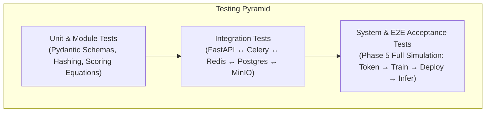

# Software Test Plan (STP): Project NetworkNebula
## Enterprise B2B Decentralized AI Compute & Model Serving Network

> **Course:** Intro2SE (Software Engineering) · School of Computer Science, Ariel University  
> **Course Lecturer:** Prof. Boaz Ben-Moshe  
> **Document Code:** STP-NN-2026-v1.0  
> **Traceability Reference:** Verifies [SRS Functional & Non-Functional Requirements](file:///c:/Users/ohadb/Desktop/ALL/APPS/Project%20NetworkNebula/docs/SRS.md) and validates [SOW Deliverables](file:///c:/Users/ohadb/Desktop/ALL/APPS/Project%20NetworkNebula/docs/SOW.md)  
> **Target Audience:** Test Lead, QA Engineers, DevOps, System Evaluators  
> **Test Execution Framework:** Python `test_suite.py`, Pytest, Playwright (UI)

---

## 1. Scope & Items Under Test

The scope of this test plan encompasses the complete end-to-end functionality of Project NetworkNebula across its containerized services:
1. **Authentication & Multi-Tenant Scopes:** JWT token generation, API keys, password hashing, and token revocation.
2. **Data & Storage Persistence:** PostgreSQL tables, Alembic migrations, and MinIO S3 bucket hierarchies (`nebula-datasets`, `nebula-checkpoints`, `nebula-models`).
3. **Enterprise Training Pipeline:** JSONL dataset parsing, PyTorch PEFT/LoRA training execution, epoch loss logging, and safetensors checkpoint upload.
4. **OpenAI-Compatible Inference Gateway:** `/v1/chat/completions`, streaming SSE tokens, token deduction ledger, and response latency.
5. **Decentralized Host Fleet & Worker Management:** Node registration, GPU telemetry discovery (`pynvml`), heartbeat maintenance, staking, slashing, and Celery task dispatch.
6. **Web Console UI:** React 19 / Vite build validation and end-to-end browser flows.

---

## 2. Test Levels & Strategy

NetworkNebula employs a comprehensive multi-tier testing strategy:

### 2.1 Unit Testing
- **Target:** Isolated functions, data models, and utility algorithms.
- **Coverage:** Pydantic validation, cryptographic hash generation, worker priority scoring formula, and ledger balance math.
- **Tooling:** Python `pytest` and built-in unit tests in `test_suite.py`.

### 2.2 Integration Testing
- **Target:** Inter-process communication between FastAPI, Redis, PostgreSQL, and MinIO.
- **Coverage:** Presigned S3 URL upload/download verification, Celery task enqueue/dequeue, and database relational cascades.

### 2.3 System & End-to-End (E2E) Acceptance Testing
- **Target:** Complete customer workflows simulated in an automated sequence:
  `Register User` &rarr; `Generate Scoped API Token` &rarr; `Upload Dataset` &rarr; `Train LoRA Adapter` &rarr; `Download Checkpoint` &rarr; `Serve Chat Completion via OpenAI SDK` &rarr; `Verify Double-Entry Ledger`.
- **Tooling:** Master Test Suite runner (`test_suite.py`).

### 2.4 Performance & Stress Testing
- **Target:** API gateway throughput (RPS), time-to-first-token (TTFT), and worker failover recovery time.

---

## 3. Test Approach & Tooling

| Testing Category | Tool / Framework | Execution Command | Target SLA |
| :--- | :--- | :--- | :--- |
| **Unified Master Suite** | `test_suite.py` (Custom Authoritative Runner) | `python test_suite.py` | 100% Pass Rate (0 failures) |
| **API Integration** | Python `requests` & `urllib` | Integrated in `test_suite.py` | $< 500\text{ ms}$ TTFT |
| **Object Storage S3** | MinIO Python SDK / `boto3` | Integrated in `test_suite.py` | Valid HTTP 200 on GET/PUT |
| **Frontend UI Build** | Bun / TypeScript Compiler (`tsc`) | `bun run build` in `network-nebula/` | 0 TypeScript Errors |
| **Frontend E2E** | Playwright | `npx playwright test` | All critical paths render |

---

## 4. Test Environment & Data Management

### 4.1 Environments
- **Local Dev / CI Environment:** Windows 11 / Ubuntu 22.04 with Docker Desktop or standalone Python environment.
- **Target Production Environment:** Docker Compose stack defined in `docker-compose.server.yml` running services on ports `80`, `8000`, `9000`, `5432`, and `6379`.

### 4.2 Test Data Strategy
- **Synthetic Datasets:** Pre-generated JSONL files containing valid instruction/response pairs (e.g., `test_dataset.jsonl`) used for automated training tests.
- **Ephemeral Test Accounts:** Automated tests generate dynamic accounts (`test_user_<uuid>@nebula.ai`) with seeded test balances ($50.00) that are cleaned up or isolated in local test DB instances.
- **Hardware Isolation:** Test suite automatically detects GPU availability; if CUDA is unavailable, tests seamlessly exercise the CPU simulation fallback without failing assertions.

---

## 5. Entry & Exit Criteria

### 5.1 Entry Criteria
- Code compiles without syntax or type errors.
- Target database migrations apply cleanly (`alembic upgrade head`).
- Core services (Postgres, Redis, MinIO) report healthy status via docker healthchecks.

### 5.2 Exit Criteria (Definition of Done)
1. **Zero Critical/Blocker Bugs:** No open issues that prevent token generation, inference serving, or worker registration.
2. **100% Green Master Suite:** All phases in `test_suite.py` pass without any `[FAIL]` indicators.
3. **Frontend Compilation:** `bun run build` generates clean production bundles with exit code 0.
4. **Traceability Closure:** 100% of functional requirements (`REQ-01` to `REQ-19`) mapped to verified test cases in `STD.md`.

---

## 6. Roles, Responsibilities & Schedule

| Role | Individual / Group | Responsibilities |
| :--- | :--- | :--- |
| **Test Lead** | QA Architecture | Defines test plan, approves exit criteria, maintains `test_suite.py` |
| **Backend Tester** | Backend Engineers | Implements unit and integration tests for APIs, Celery, and DB |
| **Frontend Tester** | Frontend Team | Runs Playwright tests and validates UI console flows |
| **DevOps / CI** | Systems Engineer | Automates regression test runs upon git push and pull requests |

---

## 7. Risks & Contingency Actions

| Identified Risk | Likelihood | Impact | Mitigation Plan |
| :--- | :--- | :--- | :--- |
| **Worker node disconnection during long training run** | Medium | High | STP mandates testing automatic task requeueing and epoch checkpoint recovery. |
| **MinIO S3 service unreachable** | Low | High | Local mock S3 fallback implemented in `app/storage.py` for testing continuity. |
| **CUDA out-of-memory (OOM) on low-spec GPUs** | Medium | Medium | Automated gradient checkpointing and dynamic batch reduction tests. |
