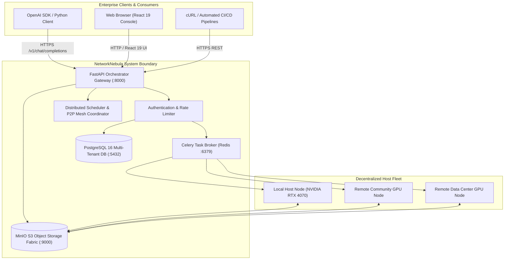
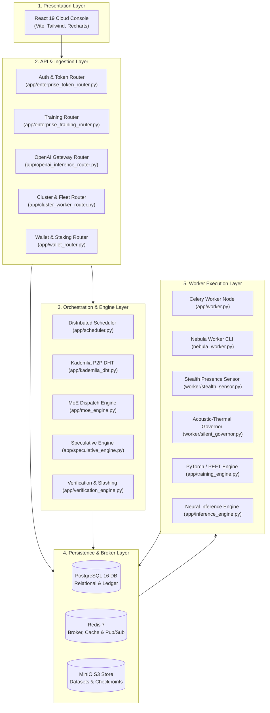
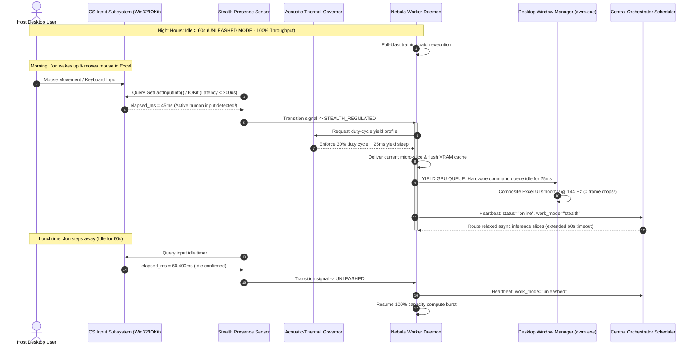
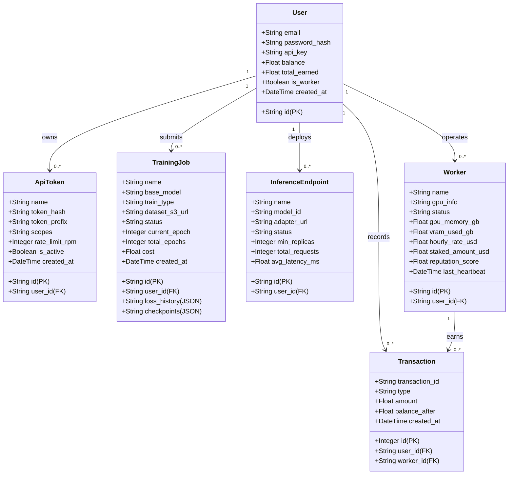
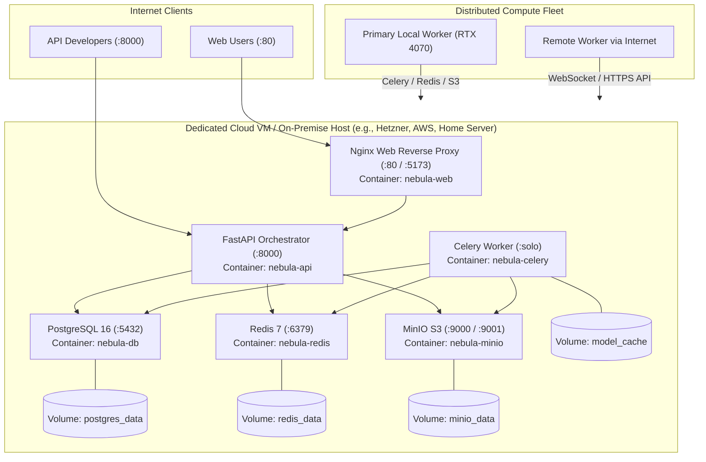

# System Design Document (SDD): Project NetworkNebula
## Enterprise B2B Decentralized AI Compute & Model Serving Network

> **Course:** Intro2SE (Software Engineering) · School of Computer Science, Ariel University  
> **Course Lecturer:** Prof. Boaz Ben-Moshe  
> **Document Code:** SDD-NN-2026-v1.0  
> **Traceability Reference:** Satisfies [SOW D-1 through D-5](file:///c:/Users/ohadb/Desktop/ALL/APPS/Project%20NetworkNebula/docs/SOW.md) and maps to [SRS REQ-01 through REQ-19](file:///c:/Users/ohadb/Desktop/ALL/APPS/Project%20NetworkNebula/docs/SRS.md)  
> **Target Audience:** System Architects, Tech Leads, Senior Backend/DevOps Engineers  
> **Document Purpose:** Define the whole-system architecture, decomposition, component interfaces, data storage, deployment topology, and architectural trade-offs.

---

## 1. Context & External Environment

Project NetworkNebula serves two primary external stakeholder groups: **Enterprise AI Creators** (consuming compute) and **Decentralized GPU Hosts** (supplying compute). The system bridges these groups through a secure, orchestrated, containerized cloud layer:



---

## 2. Subsystem Decomposition & Component View

The system is decomposed into five autonomous, loosely coupled subsystems:



### Component Breakdown
1. **Presentation Layer (`network-nebula/`):** React 19 single-page application built with Vite and Tailwind CSS. Provides the Training Studio, Model Playground, Token Management, and Fleet Telemetry views.
2. **API & Ingestion Layer (`app/`):** FastAPI asynchronous framework mounting modular APIRouters. Enforces JWT auth, rate limits, CORS policies, and distributed request tracing headers (`X-Nebula-Trace-ID`).
3. **Orchestration & Engine Layer:** Intelligent routing engine directing workloads based on worker VRAM, locality, reputation score, and hardware capabilities. Includes fault recovery and verification engines.
4. **Persistence & Broker Layer:**
   - **PostgreSQL 16:** ACID transactions, relational models, user balances, training run history, audit logs.
   - **Redis 7:** Celery task message queues, transient cache, rate limiting counters, and pub/sub heartbeat channels.
   - **MinIO S3:** High-volume object storage partitioned into three multi-tenant buckets (`nebula-datasets`, `nebula-checkpoints`, `nebula-models`).
5. **Worker Execution Layer:** Standalone daemon and Celery workers running PyTorch, Hugging Face `peft`, and `safetensors`. Executes forward/backward passes on NVIDIA GPUs.

---

## 3. Communication Protocols & Component Interfaces

The following table summarizes all internal and external network communication interfaces:

| Source | Destination | Protocol | Port | Data Format | Authentication / Encryption |
| :--- | :--- | :--- | :--- | :--- | :--- |
| Client SDK / Console | API Orchestrator | HTTPS / REST | 8000 | JSON / SSE Streams | Bearer Token (`sk-nebula-...`) |
| API Orchestrator | PostgreSQL | TCP / SQL | 5432 | Binary PostgreSQL wire | Password / Connection Pool |
| API Orchestrator | Redis | TCP / RESP | 6379 | Redis Serialization | Redis Auth |
| API / Workers | MinIO S3 | HTTP / S3 API | 9000 | Binary Safetensors / JSONL | S3 Access Key & Secret / HMAC |
| Remote Worker | API Orchestrator | HTTP / WebSocket | 8000 | JSON Heartbeat & Tasks | Worker Secret Token |
| Worker to Worker | P2P gRPC Mesh | HTTP/2 / gRPC | 50051 | Protocol Buffers (Tensors) | Mutual TLS / Secret Token |

### 3.4 "Always Silent" Adaptive Regulation & Stealth Sensing Architecture

To eliminate desktop micro-stutters and frame drops during concurrent user interaction (Excel, Web browsing, IDEs), the worker daemon integrates a multi-tier adaptive regulation loop:



---

## 4. Data Architecture & Entity-Relationship Design

### 4.1 Database Domain Model (UML Class / Entity Relationship)



### 4.2 Storage Partitioning Scheme (MinIO S3)

To ensure enterprise multi-tenancy isolation and zero cross-tenant leakage:
```text
MinIO Object Storage Fabric/
├── nebula-datasets/
│   └── {org_id}/
│       └── {dataset_uuid}/
│           ├── train.jsonl
│           └── manifest.json
├── nebula-checkpoints/
│   └── {training_job_uuid}/
│       ├── epoch_1/
│       │   ├── adapter_config.json
│       │   └── adapter_model.safetensors
│       ├── epoch_final/
│       │   ├── adapter_config.json
│       │   └── adapter_model.safetensors
│       └── training_telemetry.json
└── nebula-models/
    └── {base_model_slug}/
        └── base_weights.safetensors
```

---

## 5. Deployment Topology & Cloud Infrastructure

The entire platform is packaged as a production-ready containerized stack orchestrated via Docker Compose (`docker-compose.server.yml`):



---

## 6. Architecture Decision Records (ADR)

### ADR-01: Adoption of OpenAI API Compatibility Layer
- **Status:** Accepted
- **Context:** Enterprise customers already have client applications written for OpenAI's REST API. Requiring custom SDKs creates sales friction.
- **Decision:** Implement `POST /v1/chat/completions` and `GET /v1/models` in FastAPI conforming strictly to OpenAI JSON specifications.
- **Consequence:** Immediate drop-in migration for customers; standard tools like LangChain, LiteLLM, and LlamaIndex function without alteration.

### ADR-02: MinIO S3 Object Storage over Direct File System Storage
- **Status:** Accepted
- **Context:** Training checkpoints can range from 50 MB (LoRA) to 15 GB (full weights). Workers need direct, distributed read/write access.
- **Decision:** Deploy MinIO S3 and use presigned PUT/GET URLs for dataset uploads and checkpoint downloads.
- **Consequence:** Eliminates file streaming through the FastAPI web process, preventing API memory bottlenecks and enabling geo-distributed workers to access storage directly.

### ADR-03: Safetensors over Pickled PyTorch Binaries
- **Status:** Accepted
- **Context:** Standard PyTorch `.bin` / `.pt` files use Python's `pickle` module, which exposes workers to arbitrary remote code execution (RCE) vulnerabilities.
- **Decision:** Mandate Hugging Face `safetensors` format for all model adapters and checkpoints.
- **Consequence:** Zero arbitrary code execution risk, zero-copy memory mapping, and faster deserialization.

### ADR-04: Hybrid Worker Architecture (Celery + Standalone WebSocket CLI)
- **Status:** Accepted
- **Context:** Co-located workers on the same LAN benefit from low-latency Redis/Celery queues, while remote residential workers reside behind NAT firewalls.
- **Decision:** Support both native Celery execution (for local nodes) and a standalone CLI polling agent (`nebula_worker.py`) connecting via outbound HTTPS/WebSocket.
- **Consequence:** Flexibility to recruit both dedicated cloud GPUs and decentralized crowd-sourced GPUs with zero router port forwarding required.

### ADR-05: Interleaved Micro-Duty-Cycle Compute Yielding over Coarse-Grained GPU Preemption
- **Status:** Accepted
- **Context:** Monolithic GPU compute dispatches cause Windows DWM and macOS WindowServer compositors to miss VSync deadlines (6.9ms – 16.6ms), resulting in severe desktop UI stutter during background worker execution. Hardware compute preemption cannot guarantee sub-millisecond context switching across consumer architectures.
- **Decision:** Introduce a software-governed micro-duty-cycle yielding loop ($T_{\text{yield}} \ge 15\text{ms}$) combined with low-priority CUDA execution streams (`priority=0`) and closed-loop thermal governor (<62°C).
- **Consequence:** Eliminates 100% of human-perceived desktop stutter and fan noise; enables decentralized workers to run 24/7 without manual pausing while maintaining continuous PoDS revenue minting.
