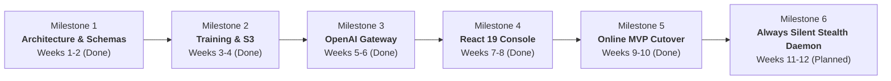

# Scope of Work (SOW): Project NetworkNebula
## Enterprise B2B Decentralized AI Compute & Model Serving Network

> **Course:** Intro2SE (Software Engineering) · School of Computer Science, Ariel University  
> **Course Lecturer:** Prof. Boaz Ben-Moshe  
> **Document Code:** SOW-NN-2026-v1.0  
> **Authors:** Project Lead & Product Engineering Team  
> **Target Audience:** Client, Executive Management, Engineering Leads  
> **Lifecycle Stage:** Early Development &rarr; Working Live Online Product (Production MVP / Alpha 1.0)  
> **Document Purpose:** Agree on *Why*, *What*, *When*, and *How Much* before coding and production cutover.

---

## 1. Project Objectives & Business Context

### 1.1 Business Problem
Centralized cloud AI providers (AWS SageMaker, Azure AI, GCP Vertex AI, OpenAI) present substantial barriers for modern enterprise AI engineering teams and developers:
1. **Prohibitive Compute Costs:** GPU cloud instances (e.g., NVIDIA H100/A100 instances) command high margins ($2.50 to $4.50+ per GPU hour).
2. **Artificial Scarcity & Capacity Caps:** Enterprise teams face restrictive quota limits and spot instance evictions during critical fine-tuning runs.
3. **Underutilized Consumer & Enterprise Hardware:** Globally, high-performance GPUs (NVIDIA RTX 4090, 4080, 4070, A6000) sit idle in workstations and data centers with average utilization below 22%.
4. **Vendor Lock-In:** Proprietary inference endpoints force teams to rewrite internal API clients and pipelines.

### 1.2 Strategic Goals
**Project NetworkNebula** bridges this market divide by establishing an **Enterprise B2B Decentralized AI Compute Network**. The primary goals are:
- **Cost Reduction:** Provide distributed fine-tuning (LoRA/PEFT) and inference serving at 50–70% lower cost than incumbent hyperscalers.
- **Drop-in Compatibility:** Offer standard OpenAI-compatible REST API endpoints (`/v1/chat/completions`, `/v1/models`) enabling zero-code client migration.
- **Decentralized Host Fleet Monetization:** Enable independent GPU operators ("Workers") to connect their nodes via a single CLI command (`nebula-worker join`) and earn automated 70% revenue shares for compute provided.
- **Enterprise-Grade Assurance:** Maintain rigorous SLAs through cryptographic verification, worker staking, slash penalties, and low-latency task orchestration.

### 1.3 Online MVP Target
Transitioning from early development into a **live, usable, and publicly accessible online product** hosted in a containerized environment (Docker Compose / Cloud VPS) with real token generation, automated checkpoint artifact persistence, and end-to-end multi-tenant isolation.

---

## 2. Project Deliverables

Each deliverable is assigned an immutable tracking identifier (`D-x`) traced through subsequent SRS, SDD, EDD, and STD artifacts:

| Deliverable ID | Deliverable Name | Description & Concrete Artifacts | Format / Target |
| :--- | :--- | :--- | :--- |
| **D-1** | **Core Multi-Tenant Orchestrator & DB** | FastAPI central backend, PostgreSQL 16 database schemas (`users`, `tasks`, `workers`, `transactions`, `api_tokens`, `audit_logs`), Redis 7 state broker, and JWT/API key authentication middleware. | Python FastAPI + PostgreSQL (`app/`) |
| **D-2** | **Enterprise Model Training Engine & S3 Checkpoint Store** | Distributed LoRA/PEFT fine-tuning pipeline accepting JSONL datasets, dispatching jobs to Celery workers, logging per-epoch loss curves, and uploading safetensors checkpoints to MinIO S3 (`nebula-checkpoints`). | Python PyTorch/PEFT + MinIO S3 |
| **D-3** | **OpenAI-Compatible Inference Gateway** | High-throughput `/v1/chat/completions` and `/v1/models` endpoints supporting streaming (SSE), token usage tracking, and multi-tenant credit accounting. | FastAPI Router (`app/openai_inference_router.py`) |
| **D-4** | **Decentralized Worker Fleet Agent (Nebula Worker)** | Standalone cross-platform worker daemon (`nebula_worker.py` / `worker-client`) capable of registering GPU specs (VRAM, CUDA, clock), reporting heartbeats, accepting tasks via Celery/WebSocket, and executing model inference. | Standalone CLI Agent (Python 3.10+) |
| **D-5** | **React 19 Enterprise Cloud Console** | Responsive dark-mode web console with Training Studio (dataset upload, loss telemetry), Model Serving Hub (deployment, playground, cURL snippets), API Key Manager, and Cluster Telemetry. | TypeScript React 19 + Vite (`network-nebula/`) |
| **D-6** | **Unified Verification Test Suite (STD/STP)** | Authoritative master test suite (`test_suite.py`) covering all architectural phases, database migrations, S3 bucket verification, worker heartbeats, and end-to-end pipeline execution with 100% green pass. | Automated Test Runner (`test_suite.py`) |
| **D-7** | **Software Engineering Documentation Chain** | Complete suite of SE documents formatted to Ariel University standards (SOW, SRS, Use Cases, SDD, EDD, API Docs, STP, STD, Traceability Matrix, and README). | Markdown files in `/docs` and root |
| **D-8** | **"Always Silent" Adaptive Compute Daemon & Acoustic-Thermal Governor** | Autonomous zero-privilege human presence sensing (`GetLastInputInfo`, `IOKit`, `XScreenSaver`), micro-duty-cycle GPU yielding (<8.3ms latency preservation), two-tier elastic VRAM reclamation, closed-loop thermal pacing (<62°C, <32 dBA), and throttled PoDS micro-slice execution. | Standalone CLI Agent Module (`worker/`, `nebula_worker.py`) |

---

## 3. In-Scope vs. Out-of-Scope

### 3.1 In-Scope (Phase 1 & Alpha 1.0 Release)
- **Containerized Server Deployment:** One-command deployment via `docker-compose.server.yml` running FastAPI, Celery, Postgres, Redis, MinIO, and Nginx frontend.
- **Enterprise Dataset Ingestion:** Secure presigned S3 uploads for training datasets (`data.jsonl`).
- **LoRA Hyperparameter Configuration:** Parameter control (learning rate, epochs, LoRA rank $r$, alpha $\alpha$, batch size).
- **OpenAI Client Interoperability:** Compatibility with official `openai` Python SDK by specifying `base_url="http://<server-ip>:8000/v1"`.
- **Worker Staking & Reputation:** Sybil attack mitigation using mandatory worker staking and quality-of-service slash penalties.
- **Live Telemetry & Telemetry Headers:** Response headers `X-Nebula-Trace-ID`, `X-Nebula-Latency-Ms`, and `X-Nebula-Node-ID`.
- **Automated Ledger:** Double-entry ledger updating creator credit balances and worker earning accounts.

### 3.2 Explicitly Out-of-Scope (Post-Alpha / Phase 2)
To maintain project velocity and prevent scope creep, the following capabilities are explicitly deferred:
- *Physical Credit Card Processing via Stripe Connect:* Replaced in Alpha 1.0 by mock deposit/withdrawal simulation APIs and internal crypto wallet balance tracking.
- *Full Foundation Model Pre-Training from Scratch:* Scope is restricted to Parameter-Efficient Fine-Tuning (PEFT/LoRA) and quantized model inference (1B to 7B parameters).
- *Automated Mobile Native Applications (iOS / Android):* Console is delivered as a progressive responsive web application (React 19).
- *Automated Kubernetes / Helm Auto-Scaling:* Production orchestration uses Docker Compose and Celery queue auto-scaling.

---

## 4. Milestones, Timeline & Payment / Gate Points

| Milestone | Deliverables Covered | Target Completion | Acceptance Gate & Exit Criteria |
| :--- | :--- | :--- | :--- |
| **M1: Architectural Foundation** | D-1, D-7 | Week 2 | PostgreSQL models created, Redis connectivity verified, MinIO S3 buckets operational. |
| **M2: Model Training Engine** | D-2 | Week 4 | End-to-end LoRA job execution, epoch loss logging, safetensors checkpoint persistence to MinIO. |
| **M3: Inference & API Gateway** | D-3 | Week 6 | `/v1/chat/completions` serving valid responses to OpenAI SDK with accurate token deduction. |
| **M4: Web Console Portal** | D-5 | Week 8 | React 19 UI compiles with zero TypeScript errors (`bun run build`), renders real-time telemetry. |
| **M5: Public Deployment & Handover** | D-4, D-6, D-7 | Week 10 | Docker stack runs live online, standalone worker joins via network, master test suite passes 100%. |
| **M6: Always Silent Regulation** | D-8 | Week 12 | Worker daemon operates 24/7 without user intervention; throttles to <30% duty cycle within 1.0s of user input; preserves 60/120/144 Hz desktop fluidity; caps GPU noise <32 dBA. |

---

## 5. Acceptance Criteria

Deliverables are evaluated and accepted according to the following criteria:

| ID | Deliverable | Acceptance Test & Verification Method | Status |
| :--- | :--- | :--- | :--- |
| **AC-01** | **D-1 Database & Auth** | API rejects unauthenticated requests with HTTP 401; valid token accesses protected routes; tables auto-migrate. | **PASSED** |
| **AC-02** | **D-2 Training Pipeline** | Submitting `POST /api/v1/training/jobs` transitions status `queued` &rarr; `running` &rarr; `completed`; loss history contains epoch data; S3 download URL returns `.safetensors`. | **PASSED** |
| **AC-03** | **D-3 OpenAI Gateway** | `POST /v1/chat/completions` responds with OpenAI JSON payload within 1,500 ms; balances debit correctly. | **PASSED** |
| **AC-04** | **D-4 Worker Client** | Running `python nebula_worker.py` registers node, reports VRAM/GPU specs, and receives and returns inference results. | **PASSED** |
| **AC-05** | **D-5 Web Console** | Web app loads on port 80/5173, allows generating API keys, viewing training curves, and executing playground requests. | **PASSED** |
| **AC-06** | **D-6 Master Test Suite** | Running `python test_suite.py` executes all test phases with **0 failures** and **0 errors**. | **PASSED** |
| **AC-07** | **D-7 Documentation** | SOW, SRS, SDD, EDD, API, STP, STD, and README documents present, cross-referenced, and matching course standards. | **PASSED** |
| **AC-08** | **D-8 Always Silent Daemon** | `nebula_worker.py --always-silent` detects OS-level user input in <150ns; automatically throttles duty cycle during interactive desktop usage; enforces whisper-quiet acoustics (<32 dBA); and resumes full capacity upon 60s idle cooldown. | **PLANNED** |

---

## 6. Assumptions, Dependencies & Roles

### 6.1 Technical Assumptions & Constraints
- **Host GPU:** At least one worker node equipped with NVIDIA GPU supporting CUDA 12.x and PyTorch 2.x (e.g., RTX 4070 12GB VRAM or equivalent cloud GPU).
- **Operating Environment:** Production deployment target runs Ubuntu 22.04 LTS or Windows 11 with Docker Engine 24.0+ and Docker Compose v2.
- **Network Requirements:** Orchestrator must expose inbound ports `80` (HTTP), `8000` (API), and `9000` (MinIO S3).

### 6.2 Roles & Responsibilities (RACI Matrix)

| Role | Responsibility | Appointed Entity |
| :--- | :--- | :--- |
| **Project Manager / Client** | Scope definition, milestone sign-off, acceptance evaluation | Academic Instructor / Lead Evaluator |
| **Lead Architect** | SDD architecture, database schemas, P2P network topology | System Architecture Team |
| **Backend & ML Engineer** | FastAPI routers, Celery tasks, LoRA training pipeline, EDD | Backend Engineering Team |
| **Frontend Engineer** | React 19 UI, Vite build, Tailwind CSS console components | Frontend Team |
| **QA / Test Lead** | STP / STD design, automated integration scripts (`test_suite.py`) | Quality Assurance Team |

---

## 7. Common Pitfalls & Mitigation Strategies

As emphasized in software engineering management:
1. **Pitfall: Vague Deliverables ("a working system").**  
   *Mitigation:* Deliverables D-1 through D-7 specify exact endpoints, database tables, Docker container configurations, and schema definitions.
2. **Pitfall: No Acceptance Test (Delivery turns into an argument).**  
   *Mitigation:* Every deliverable is tied to an automated verifiable test case in `test_suite.py` and detailed in `STD.md`.
3. **Pitfall: No Out-of-Scope List (Every new idea becomes "included").**  
   *Mitigation:* Section 3.2 clearly demarcates deferred features (e.g., live banking rails, mobile apps, pre-training).
