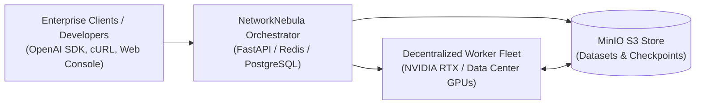
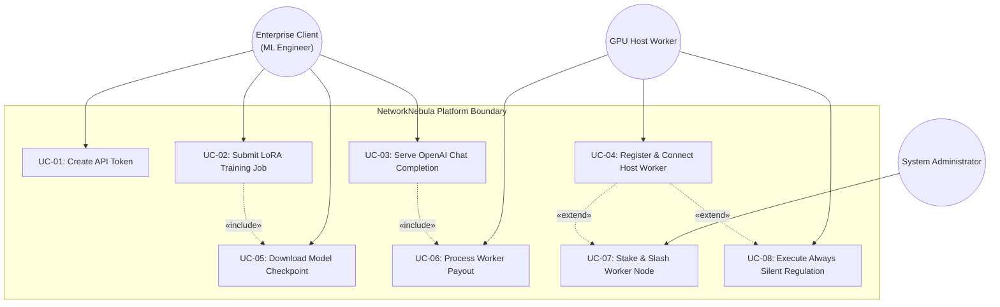
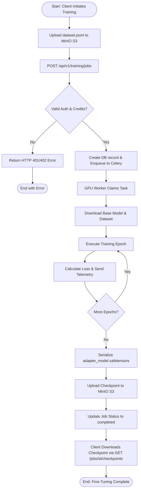

# Software Requirements Specification (SRS): Project NetworkNebula
## Enterprise B2B Decentralized AI Compute & Model Serving Network

> **Course:** Intro2SE (Software Engineering) · School of Computer Science, Ariel University  
> **Course Lecturer:** Prof. Boaz Ben-Moshe  
> **Document Code:** SRS-NN-2026-v1.0  
> **Traceability Reference:** Extends SOW deliverables [D-1 through D-7](file:///c:/Users/ohadb/Desktop/ALL/APPS/Project%20NetworkNebula/docs/SOW.md)  
> **Target Audience:** Developers, Test Engineers, Architects, Technical Evaluators  
> **Standard:** IEEE 830 / ISO-IEC-IEEE 29148 Standard Compliant Structure

---

## 1. Introduction

### 1.1 Purpose
This Software Requirements Specification (SRS) defines the functional, non-functional, external interface, and behavioral requirements for **Project NetworkNebula** — an Enterprise B2B Decentralized AI Compute and Model Serving Platform. This document serves as the contract between project stakeholders and development teams, governing system implementation and verification.

### 1.2 Scope
NetworkNebula encompasses a cloud orchestrator, a decentralized GPU worker network, object storage synchronization, an OpenAI-compatible inference gateway, and an enterprise management console. The system allows enterprise clients to fine-tune open-source models using custom datasets and deploy models for inference at low cost, while compensating decentralized GPU providers.

### 1.3 Definitions, Acronyms, and Abbreviations
- **API:** Application Programming Interface
- **LoRA:** Low-Rank Adaptation (parameter-efficient fine-tuning technique)
- **PEFT:** Parameter-Efficient Fine-Tuning
- **VRAM:** Video Random Access Memory (GPU memory)
- **S3:** Simple Storage Service (MinIO object storage protocol)
- **SSE:** Server-Sent Events (used for streaming token inference)
- **Worker:** A compute node hosting one or more GPUs contributing compute to the network
- **Creator / Enterprise Client:** An authenticated business user submitting training jobs or inference requests
- **DHT:** Distributed Hash Table (Kademlia-based P2P routing)
- **SLA:** Service Level Agreement

### 1.4 References
1. *Intro2SE Lecture 02a: Software Engineering Documents*, Boaz Ben-Moshe, Ariel University.
2. *Project NetworkNebula Scope of Work (SOW)*, `docs/SOW.md`.
3. *OpenAI API Reference Specification* (v1/chat/completions).
4. *IEEE Recommended Practice for Software Requirements Specifications* (IEEE Std 830-1998).

---

## 2. Overall Description

### 2.1 Product Perspective
NetworkNebula operates as a decentralized cloud architecture. It sits between enterprise clients seeking compute and decentralized host nodes providing GPU hardware:

### 2.2 User Classes and Characteristics
1. **Enterprise ML Engineer (Client):** Submits datasets, launches LoRA fine-tuning jobs, configures hyper-parameters, downloads safetensors checkpoints, and integrates inference endpoints into enterprise apps.
2. **GPU Host Worker:** Connects computing hardware via the CLI agent, stakes capital to guarantee reliability, processes jobs, and receives automated payouts.
3. **Network Administrator:** Monitors network health, tracks active workers, reviews audit logs, and handles disputes or slashing events.

### 2.3 Operating Environment
- **Server Orchestrator:** Docker 24+, Ubuntu 22.04 LTS / Windows 11 host, 4 vCPU, 8 GB RAM, 50 GB SSD.
- **Worker Nodes:** Windows / Linux, NVIDIA GPU (compute capability $\ge 8.0$), CUDA 12.x+, minimum 8 GB VRAM, Python 3.10+.
- **Web Console Client:** Modern web browser (Chrome 120+, Firefox 120+, Safari 17+, Edge 120+).

### 2.4 Design and Implementation Constraints
- **CON-01:** System must maintain 100% backward compatibility with OpenAI `/v1/chat/completions` API schema.
- **CON-02:** All sensitive credentials, API keys, and passwords must be stored hashed (Argon2 / PBKDF2 / SHA-256).
- **CON-03:** Weights and checkpoints must be formatted in safe serialized tensors (`safetensors`), strictly prohibiting unpickled Python binaries.
- **CON-04:** Distributed job scheduling must use Redis queue backends with Celery task isolation.

### 2.5 Assumptions and Dependencies
- Network connectivity with sufficient upload/download bandwidth for dataset transfers ($> 20 \text{ Mbps}$).
- MinIO service is reachable internally via S3 API protocols over port 9000.

---

## 3. Specific Requirements

### 3.1 Functional Requirements
Requirements are stated in unambiguous, verifiable terms using the standard "The system shall..." syntax.

#### Module 1: Authentication & Multi-Tenant Management
- **REQ-01 (User Registration & Authentication):** The system shall allow users to register an account with a unique email and password, returning an authenticated JWT token and an API key pair (`api_key` and `api_secret`).
- **REQ-02 (Enterprise API Tokens):** The system shall enable creators to generate scoped API tokens (scopes: `training`, `inference`, `admin`) with configurable rate limits (default: 60 RPM).
- **REQ-03 (Token Revocation):** The system shall provide an endpoint to immediately revoke an API token, rejecting subsequent requests with HTTP 401 Unauthorized within 100 ms of revocation.
- **REQ-04 (Account Ledger & Balance):** The system shall maintain an immutable transaction ledger for all balance deposits, task debits, and worker payout credits.

#### Module 2: Model Training Engine
- **REQ-05 (Dataset Upload URL Provisioning):** The system shall generate presigned S3 PUT URLs for uploading training datasets in JSONL format to `nebula-datasets/{org_id}/`.
- **REQ-06 (Training Job Submission):** The system shall accept training job submissions specifying base model (e.g., `llama-3.2-1b`, `qwen-2.5-0.5b`), dataset URL, epochs, learning rate, and LoRA rank $r$.
- **REQ-07 (Training Task Dispatch):** The orchestrator shall enqueue valid training jobs into Redis and dispatch them to available GPU worker nodes within 2.0 seconds of submission.
- **REQ-08 (Telemetry & Loss Tracking):** The system shall record and persist training loss metrics per epoch, updating the job's `loss_history` array in PostgreSQL.
- **REQ-09 (Checkpoint Serialization & S3 Storage):** Upon completion of training, the worker shall serialize the LoRA adapter weights as `adapter_model.safetensors` and upload them to `nebula-checkpoints/{job_id}/`.
- **REQ-10 (Checkpoint Retrieval):** The system shall provide an endpoint `GET /api/v1/training/jobs/{id}/checkpoints` returning valid presigned download URLs for trained adapter weights.

#### Module 3: Model Serving & OpenAI-Compatible Gateway
- **REQ-11 (OpenAI Chat Completions):** The system shall expose `POST /v1/chat/completions` accepting standard OpenAI request bodies (`model`, `messages`, `temperature`, `max_tokens`, `stream`).
- **REQ-12 (Streaming Inference):** When `stream: true` is requested, the system shall stream tokens using standard Server-Sent Events (`data: {...}\n\n`) ending with `data: [DONE]`.
- **REQ-13 (Model Inventory Catalog):** The system shall expose `GET /v1/models` returning a list of active foundation models and fine-tuned user adapters available for inference.
- **REQ-14 (Credit Metering & Deduction):** The system shall meter token consumption and deduct credits at \$0.001 per 1,000 tokens from the creator's balance upon completion of each inference request.
- **REQ-15 (Telemetry Header Injection):** The gateway shall inject response headers `X-Nebula-Trace-ID`, `X-Nebula-Node-ID`, and `X-Nebula-Latency-Ms` on every HTTP response.

#### Module 4: Decentralized Worker Fleet & P2P Management
- **REQ-16 (Worker Registration):** The system shall register worker nodes with hardware telemetry (GPU model, VRAM capacity, CPU cores, CUDA version) via `POST /api/v1/workers/register`.
- **REQ-17 (Worker Heartbeat & Health Check):** The worker client shall transmit heartbeats every 30 seconds; the orchestrator shall mark workers as `offline` if no heartbeat is received within 90 seconds.
- **REQ-18 (Worker Revenue Share):** The system shall credit 70% of task fees to the serving worker's balance upon successful verification of the completed task.
- **REQ-19 (Worker Staking & Slashing):** The system shall require workers to stake a minimum of \$50.00 in test credits; malicious or faulty task results shall trigger a 20% slash penalty on the staked balance.

#### Module 5: "Always Silent" Autonomous Compute Regulation & Stealth Sensing
- **REQ-20 (Zero-Privilege Human Presence Sensing):** The worker agent shall query OS input timestamps (`GetLastInputInfo` on Windows, `IOKit/HIDIdleTime` on macOS, `XScreenSaver`/Wayland D-Bus on Linux) with execution latency $\le 200 \mu\text{s}$ without requiring elevated administrator privileges or keystroke logging.
- **REQ-21 (Micro-Duty-Cycle Inter-Kernel Yielding):** When active user presence is detected ($\text{idle} < 2.0\text{s}$), the worker shall interleave compute dispatches with microsecond yield sleeps ($15\text{ms} \le T_{\text{yield}} \le 40\text{ms}$) to guarantee that Desktop Window Manager (`dwm.exe`/`WindowServer`) compositions meet frame refresh deadlines ($\ge 60\text{ Hz}$ / $\le 16.6\text{ms}$).
- **REQ-22 (Software Acoustic & Thermal Governor):** The worker daemon shall continuously sample GPU junction temperature and automatically throttle execution duty cycle to maintain temperatures below 62°C, preventing hardware cooling fans from exceeding 32 dBA.
- **REQ-23 (Elastic VRAM Dynamic Headroom):** In stealth regulated mode, the worker shall flush temporary PyTorch CUDA allocators and maintain $\ge 4.5\text{ GB}$ of unreserved physical VRAM for hardware-accelerated desktop applications (browsers, Office suite, video decoders).
- **REQ-24 (Orchestrator Adaptive Stealth Routing & PoDS Grace Period):** The orchestrator scheduler shall dynamically route asynchronous inference and relaxed PoDS micro-slices to workers reporting `"stealth"` telemetry, extending task slice timeouts from 15s to 60s to prevent unfair slashing.

---

### 3.2 External Interface Requirements

#### User Interfaces (React 19 Console)
- **INT-01:** Responsive web interface accessible on port 80/5173 rendering:
  - Dashboard overview of active endpoints and compute utilization.
  - Training Studio for dataset upload, job launch, and live interactive loss curves.
  - Model Serving Playground with prompt submission and live streaming token output.
  - API Token Management table with copy-to-clipboard functionality.
  - Worker Node Dashboard with "Always Silent" mode toggle and live stealth/unleashed state badges.

#### Software Interfaces
- **INT-02 (Storage S3):** MinIO S3 API over HTTP port 9000 using standard AWS S3 client libraries (`boto3`).
- **INT-03 (Cache / Message Broker):** Redis 7 in-memory cache and Celery broker over port 6379.
- **INT-04 (Relational Database):** PostgreSQL 16 over port 5432 / 5433 using SQLAlchemy ORM and Alembic migrations.

---

### 3.3 Non-Functional Requirements (NFR)

#### Performance Requirements
- **NFR-01 (API Response Latency):** 95% of non-streaming inference requests shall have a Time-to-First-Token (TTFT) under 450 ms for warm workers.
- **NFR-02 (Throughput Capacity):** The orchestrator API shall sustain at least 250 requests per second across gateway endpoints with CPU utilization below 75%.
- **NFR-03 (Worker Dispatch Speed):** Task dispatch latency from job submission to worker claiming shall be under 1.5 seconds under standard queue load.
- **NFR-11 (Zero Desktop UI Jitter):** Interactive desktop performance shall experience zero perceivable frame drops or typing delays ($\text{DWM composition latency} < 16.6\text{ ms}$) during concurrent stealth compute execution.
- **NFR-12 (Acoustic Noise Ceiling):** In "Always Silent" mode, worker hardware fan noise shall not exceed 35 dBA at a distance of 1.0 meter.

#### Reliability & Availability
- **NFR-04 (Service Availability):** The core orchestrator and inference gateway shall achieve 99.5% uptime during production operations.
- **NFR-05 (Worker Fault Tolerance):** If a worker node disconnects during task execution, the orchestrator shall re-queue the task to an alternative active worker within 5 seconds.

#### Security Requirements
- **NFR-06 (Data Isolation):** S3 buckets and database rows must enforce strict multi-tenant isolation by user ID and organization ID.
- **NFR-07 (Cryptographic Storage):** Passwords must be hashed using PBKDF2/Argon2; API keys must be stored as SHA-256 hashes with only prefixes exposed.
- **NFR-08 (Payload Sanitization):** All incoming JSON bodies must be validated via Pydantic schemas, blocking malformed inputs with HTTP 422 Unprocessable Entity.

#### Usability & Maintainability
- **NFR-09 (Zero-Configuration Client):** Any application using the official OpenAI Python or Node SDK must be able to switch to NetworkNebula by only changing `base_url` and `api_key`.
- **NFR-10 (Test Coverage & Automation):** Master test suite (`test_suite.py`) shall maintain $\ge 90\%$ code coverage across all core routers and service layers.

---

## 4. Use Cases & Behavioral Models

### 4.1 UML Use Case Diagram

---

### 4.2 Detailed Use Case Specifications

#### UC-01: Submit LoRA Fine-Tuning Job
- **Use Case ID:** UC-01
- **Actor:** Enterprise Client (ML Engineer)
- **Preconditions:** Client has an active account, a valid API token with `training` scope, and balance $\ge \$5.00$.
- **Main Success Flow:**
  1. Client requests presigned S3 upload URL from `POST /api/v1/training/upload-url`.
  2. System returns presigned PUT URL for `nebula-datasets/{org_id}/dataset.jsonl`.
  3. Client uploads dataset directly to MinIO S3.
  4. Client submits job configuration to `POST /api/v1/training/jobs` (base model, dataset URL, epochs: 5, lr: 0.0002, rank: 16).
  5. System validates parameters and checks credit balance.
  6. System creates `TrainingJob` record in PostgreSQL with status `queued`.
  7. System enqueues job into Redis Celery queue.
  8. System returns HTTP 201 Created with `job_id`.
- **Alternative Flows:**
  - *5a. Insufficient Credit Balance:* System returns HTTP 402 Payment Required ("Insufficient credits to launch training job").
  - *5b. Invalid JSONL schema:* S3 pre-check detects malformed data; system returns HTTP 400 Bad Request.
  - *7a. No GPU workers available:* System retains job in `queued` status and alerts client with estimated wait time.
- **Postconditions:** Training job is queued or actively executing; creator balance is held in escrow.

---

#### UC-02: Serve OpenAI Chat Completion
- **Use Case ID:** UC-02
- **Actor:** Enterprise Application / Developer Client
- **Preconditions:** Client provides valid Bearer API Token; target model is online in model inventory.
- **Main Success Flow:**
  1. Client sends HTTP POST to `/v1/chat/completions` with JSON payload (`model`, `messages`, `max_tokens`).
  2. Gateway authenticates API token and checks rate limits.
  3. Gateway deducts estimated credit allowance.
  4. Gateway dispatches prompt to the optimal warm GPU worker in the pool.
  5. Worker executes forward pass through model weights in VRAM.
  6. Worker returns generated token stream or full completion text to Gateway.
  7. Gateway records exact token usage and credits 70% of fee to worker's balance.
  8. Gateway returns HTTP 200 with standard OpenAI JSON completion object and telemetry headers.
- **Alternative Flows:**
  - *2a. Invalid API Token:* System returns HTTP 401 Unauthorized.
  - *2b. Rate Limit Exceeded:* System returns HTTP 429 Too Many Requests with `Retry-After` header.
  - *4a. Worker Timeout / OOM:* Gateway fails over to secondary warm worker within 500 ms without user error.
- **Postconditions:** Accurate token usage recorded in `transactions` table; client receives generated response.

---

#### UC-03: Register & Join Worker to Compute Fleet
- **Use Case ID:** UC-03
- **Actor:** GPU Host Worker
- **Preconditions:** Worker client has installed `nebula_worker.py` and has network access to Orchestrator API.
- **Main Success Flow:**
  1. Worker executes `python nebula_worker.py join --server http://<server-ip>:8000 --key <worker_key>`.
  2. Worker queries local NVIDIA management library (`pynvml` / `nvidia-smi`) for GPU specs (model, VRAM, CUDA version).
  3. Worker sends registration payload to `POST /api/v1/workers/register`.
  4. System validates worker key and registers node in `workers` table with status `ready`.
  5. Worker starts background heartbeat thread sending ping every 30 seconds.
  6. Worker joins Celery worker pool and begins listening for inference and training tasks.
- **Alternative Flows:**
  - *2a. No CUDA GPU Detected:* Worker client notifies user and defaults to CPU simulation mode with restricted task types.
  - *4a. Worker Staking Requirement Unmet:* System assigns worker `unverified` status with low-priority task allocation.
- **Postconditions:** Worker node is displayed on the Cloud Console Fleet Telemetry page and eligible for jobs.

---

#### UC-08: Execute in Always Silent Regulated Mode
- **Use Case ID:** UC-08
- **Actor:** GPU Host Worker / Desktop User ("Jon")
- **Preconditions:** Worker daemon is launched with `--always-silent` flag or toggled ON via the Cloud Console.
- **Main Success Flow:**
  1. Worker operates 24/7 in background without manual user pause or stop commands.
  2. While the desktop host is idle ($\text{idle} > 60\text{s}$), worker operates in **Unleashed Mode** (100% compute duty cycle, full batch throughput, maximum PoDS revenue).
  3. When human presence is detected via OS input events ($\text{idle} < 2.0\text{s}$), the daemon transitions in $<200\text{ms}$ to **Stealth Regulated Mode**.
  4. Worker delivers current micro-slice, releases cached VRAM allocations ($\ge 4.5\text{ GB}$ free), and paces future execution with $15\text{ms}–40\text{ms}$ yield sleeps.
  5. Desktop Window Manager (`dwm.exe`/`WindowServer`) receives clear GPU queues; interactive desktop tasks (Excel, Web, VS Code) maintain 60/120/144 Hz frame rates with zero noticeable stutter.
  6. Closed-loop software thermal governor restricts GPU junction temperature below 62°C, preventing hardware fans from exceeding whisper levels (<32 dBA).
  7. When user presence ceases for 60 consecutive seconds, worker autonomously ramps back up to Unleashed Mode.
- **Alternative Flows:**
  - *3a. Fullscreen 3D Game / VR Launched:* Daemon detects `QUNS_RUNNING_D3D_FULL_SCREEN` and enters **Restricted Pause** (0% compute, yields 100% GPU until game exits).
  - *4a. Active Video Playback:* If media audio/video decode is detected despite 0 mouse input, daemon remains in Stealth Regulated Mode to prevent fan noise during media consumption.
- **Postconditions:** Continuous PoDS micro-rewards earned 24/7; zero desktop interference or user-perceived performance degradation.

---

### 4.3 UML Activity Diagram: Training Job Lifecycle (UC-01)

---

### 4.4 User Stories with Acceptance Criteria (Agile Mapping)

#### User Story US-01 (ML Engineer - Fine-Tuning)
> **As an** ML Engineer,  
> **I want to** submit a LoRA fine-tuning run with my customer support dataset,  
> **So that** I can customize an open-source LLM for our company's vocabulary without hosting expensive hardware.
- **Given** an authenticated user with \$10 in account balance and a valid `support_faq.jsonl` file,
- **When** the user submits `POST /api/v1/training/jobs` with `base_model: "llama-3.2-1b"` and `epochs: 3`,
- **Then** the job transitions to `completed`, loss is logged per epoch, and a presigned S3 URL for `adapter_model.safetensors` is generated.

#### User Story US-02 (Software Developer - OpenAI Drop-in Replacement)
> **As a** Software Developer,  
> **I want to** point my existing OpenAI Python SDK code to NetworkNebula,  
> **So that** my production app continues working seamlessly while reducing our inference cloud bill by 60%.
- **Given** an enterprise application initialized with `OpenAI(base_url="http://api.networknebula.ai/v1", api_key="sk-nebula-...")`,
- **When** the application calls `client.chat.completions.create(model="qwen-2.5-0.5b", messages=[...])`,
- **Then** the response arrives with valid text choices, token usage counts, and an HTTP 200 status code.

#### User Story US-03 (GPU Worker - Passive Monetization)
> **As a** Workstation Owner with an NVIDIA RTX 4070,  
> **I want to** run a lightweight background worker agent,  
> **So that** my GPU earns money while I am not gaming or working.
- **Given** a computer with an active internet connection and NVIDIA drivers installed,
- **When** the operator runs `python nebula_worker.py join`,
- **Then** the node registers with the cluster, accepts compute tasks, and accumulates earnings in their worker wallet.

---

## 5. Traceability Matrix Summary

| Requirement ID | SOW Deliverable | Use Case ID | Architecture Section | Verification Test Case |
| :--- | :--- | :--- | :--- | :--- |
| **REQ-01** | D-1 | UC-01 | SDD §2.2 | `TC-001` (Auth Registration) |
| **REQ-02** | D-1 | UC-01 | SDD §2.2 | `TC-002` (API Tokens) |
| **REQ-05** | D-2 | UC-01 | SDD §3.2 | `TC-004` (S3 Dataset Upload) |
| **REQ-06** | D-2 | UC-01 | SDD §3.1, EDD §2.1 | `TC-005` (Training Submission) |
| **REQ-09** | D-2 | UC-01 | EDD §2.3 | `TC-006` (Checkpoint S3) |
| **REQ-11** | D-3 | UC-02 | SDD §3.1, EDD §3.1 | `TC-007` (OpenAI Completion) |
| **REQ-12** | D-3 | UC-02 | EDD §3.2 | `TC-008` (Streaming SSE) |
| **REQ-16** | D-4 | UC-03 | SDD §4.1, EDD §4.1 | `TC-009` (Worker Registration) |
| **REQ-17** | D-4 | UC-03 | EDD §4.2 | `TC-010` (Heartbeat Monitor) |
| **REQ-18** | D-1, D-4 | UC-02, UC-03 | SDD §2.3 | `TC-011` (Revenue Share Accounting) |
