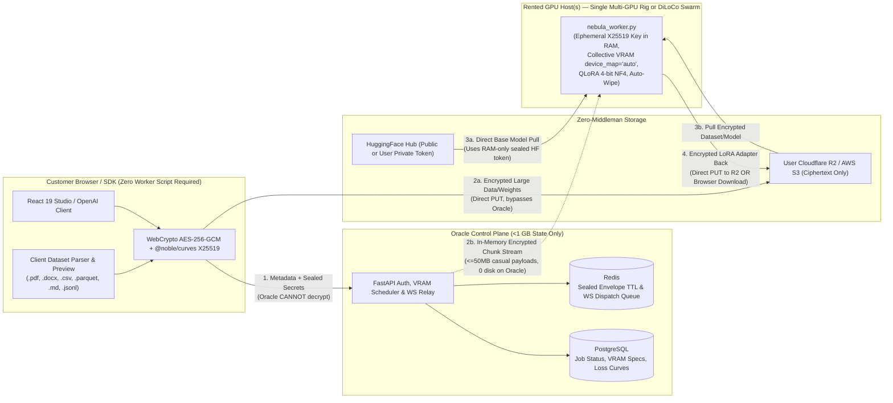

# Private BYO-Model, Universal Training Material & Zero-Middleman-Storage Architecture Specification (v2 — Marketplace-First)

> **Document Type:** Deep Market Research, Security Audit & Agent-Executable Engineering Blueprint  
> **Project:** Project NetworkNebula (`oracle-server` branch)  
> **Date:** 2026-11-10 (v2 — Streamlined around Marketplace Consumers, Smart Multi-GPU Scheduling & Zero Middleman Storage)  
> **Primary Objective:** Let paying consumers & companies fine-tune **any model** on **any training material** using NetworkNebula's GPU marketplace—**without becoming GPU workers**, **without leaking models/data between accounts**, **with near-zero storage on the coordinator server**, and **with true collective multi-GPU & VRAM-aware routing**.

---

## Table of Contents

1. [Executive Summary & Scope Refinements (v2)](#1-executive-summary--scope-refinements-v2)
2. [Target Audience Research: Consumers, Startups & High-Compute Enterprises](#2-target-audience-research-consumers-startups--high-compute-enterprises)
3. [Cryptographic, Network & Multi-GPU Efficiency Reality Check](#3-cryptographic-network--multi-gpu-efficiency-reality-check)
4. [Current Codebase Security, Scheduling & Storage Audit](#4-current-codebase-security-scheduling--storage-audit)
5. [Target Architecture: Zero-Knowledge Control Plane + Zero-Storage Data Plane](#5-target-architecture-zero-knowledge-control-plane--zero-storage-data-plane)
6. [VRAM Estimation, Collective Multi-GPU Pooling & 100-Node Scaling](#6-vram-estimation-collective-multi-gpu-pooling--100-node-scaling)
7. [Database Schema & Migrations (`app/models.py`)](#7-database-schema--migrations-appmodelspy)
8. [Implementation Plan (5 Sequential Phases for AI Builder Agent)](#8-implementation-plan-5-sequential-phases-for-ai-builder-agent)
   - [Phase 1: P0 Multi-Tenant Security Lockdown & Auth Hardening](#phase-1-p0-multi-tenant-security-lockdown--auth-hardening)
   - [Phase 2: Dynamic VRAM Routing, Collective Multi-GPU (`device_map="auto"`), Real QLoRA & Universal Data Parser](#phase-2-dynamic-vram-routing-collective-multi-gpu-device_mapauto-real-qlora--universal-data-parser)
   - [Phase 3: Zero-Storage Data Plane (Sealed Envelopes, Tunnel Stream, BYOS R2/S3 & HF Direct)](#phase-3-zero-storage-data-plane-sealed-envelopes-tunnel-stream-byos-r2s3--hf-direct)
   - [Phase 4: Web Console Studio, Client Cryptography UX & Inference Hub](#phase-4-web-console-studio-client-cryptography-ux--inference-hub)
   - [Phase 5: Automated Security, Multi-GPU VRAM & Zero-Storage E2E Test Suite](#phase-5-automated-security-multi-gpu-vram--zero-storage-e2e-test-suite)
9. [Edge Cases, Platform Traps & Mitigations](#9-edge-cases-platform-traps--mitigations)
10. [Definition of Done & Acceptance Checklist](#10-definition-of-done--acceptance-checklist)

---

## 1. Executive Summary & Scope Refinements (v2)

### 1.1 Key Product Boundary (Role Separation)
- **Customers / Companies (Demand Side):** Open an account, choose *any* model + drop *any* training material in the web browser or Python/OpenAI SDK, pay per job, and receive their trained weights. **Customers NEVER install `nebula_worker.py`, NEVER register as workers, and NEVER expose local directories.**
- **GPU Hosts (Supply Side):** Hardware owners / datacenters install `nebula_worker.py` to sell idle CUDA/ROCm/MPS capacity and earn 70% payouts.
- *(Removed from v1 as redundant for solo users: consumer-side `--model-dir` scanning and local-PC-only onboarding flows. Optional enterprise hybrid node-pinning remains supported cleanly via `allowed_worker_ids` / `strict_owner_nodes` flags if a team connects private rigs to the same fleet.)*

### 1.2 The Zero-Storage Mandate on the Coordinator Server
Our Oracle coordinator (`158.178.251.80`) has a **45 GB root disk (`30 GB` currently used, `16 GB` free)**. Acting like YouTube and storing users' 4–15 GB models/datasets centrally will break disk & egress budgets. Therefore:
1. **Standard/Private HuggingFace Base Models (0 B transferred through Oracle):** The rented GPU worker pulls weights directly from HuggingFace Hub CDN (`hf.co`) using the user's sealed ephemeral `hf_token` if gated/private.
2. **Custom Proprietary Model Weights & Large Datasets (BYOS — 0 B on Oracle):** Browser/SDK encrypts blobs locally (`AES-256-GCM`) and uploads directly to the user's own Cloudflare R2 (`$0` egress), AWS S3, or private HF repo via presigned `PUT` URLs.
3. **Small Casual Datasets & Finished LoRA Adapters (`<= 50–150 MB`, Zero-Setup — 0 B on Oracle Disk):** Encrypted chunks stream purely in memory through the API WebSocket bridge directly into Worker RAM (and the finished encrypted `.safetensors` adapter streams straight back to the user's browser download or BYOS bucket).

---

## 2. Target Audience Research: Consumers, Startups & High-Compute Enterprises

### 2.1 Audience Segments & Core Needs

1. **No-DevOps Indie Developers & AI Tinkerers:**
   - Have laptops/weak GPUs; want `7B–14B` **4-bit QLoRA** fine-tuning without managing CUDA/SSH/Docker/RunPod pods.
   - Need **arbitrary HuggingFace model IDs** (Qwen, Llama-3.x, DeepSeek-R1-Distill, Gemma, Mistral), real `val_loss` tracking, and clean `.safetensors` (or merged/GGUF-ready) output downloads.
2. **Privacy-Conscious SMBs, Agencies & Specialists (Legal, Support, Docs, Coding):**
   - Have messy documents (**`.pdf`, `.docx`, `.md`, `.txt`, `.csv`, `.parquet`, ChatML/ShareGPT `.jsonl`**), NOT pre-cleaned Alpaca JSONL.
   - Demand **strict multi-tenant isolation** (zero cross-account job, checkpoint, prompt, or endpoint visibility) and **zero file retention** on middleman servers or rented hosts.
3. **Startups & High-Compute Companies:**
   - Want **BYOS (Cloudflare R2 / S3 / Private HF)** so TB-scale datasets never touch middleman storage.
   - Need **large-scale training topologies** matched honestly to hardware:
     - **Single-Host Multi-GPU Rigs** (`2x–8x GPUs` in one machine -> collective VRAM via PCIe/NVLink `device_map="auto"` or DDP for `15–140 GB` models).
     - **DiLoCo Low-Communication Swarms** (`10–100+` consumer GPUs -> each worker computes `K` local steps on dataset shards and periodically averages LoRA weight deltas for massive datasets / GRPO / RL / synthetic evals with minimal internet overhead).
     - **SFT, QLoRA, and DPO alignment** + multi-adapter OpenAI-compatible `/v1/chat/completions` serving.

---

## 3. Cryptographic, Network & Multi-GPU Efficiency Reality Check

To preserve **98%–100% compute efficiency**, only hardware-speed techniques are included:

| Mechanism | Purpose | Speed / Overhead | Verdict |
| :--- | :--- | :--- | :--- |
| **X25519 + HKDF-SHA256 + AES-256-GCM Sealed Envelope** | Hides `hf_token`, BYOS URLs, and DEK from Oracle middleman | `<0.1 ms` handshake; `3–10 GB/s` AES-NI (`<0.5%` overhead) | **ADOPTED (Core)** |
| **Direct HF CDN Pull (for Base Models)** | Avoids uploading GBs from user's home internet & storing on Oracle | Fastest possible (`500+ MB/s` CDN to worker) | **ADOPTED (Core)** |
| **Direct R2/S3 BYOS & In-Memory WS Stream** | Zero server disk footprint | Zero server disk I/O | **ADOPTED (Core)** |
| **4-bit NF4 QLoRA + Gradient Checkpointing** | Fits `7B–14B` models inside `8–16 GB` consumer VRAM | Slight dequantize compute (~10-15%), `~70%` less VRAM | **ADOPTED (Core)** |
| **DiLoCo Periodic Sync (Low-Communication)** | Scales huge datasets across `10–100` WAN consumer GPUs | Syncs `~20 MB` LoRA delta every `K` steps (`>90%` scaling) | **ADOPTED (Phase 2/3)** |
| **Intra-Node Multi-GPU Collective VRAM (`device_map="auto"`)** | Pools `2+` GPUs on the *same* worker rig for `15 GB+` models | Full PCIe/NVLink speed inside single machine | **ADOPTED (Core)** |
| **FHE / MPC Training** | Mathematical secrecy against untrusted host | `1,000x–100,000x` slower | **REJECTED** |
| **Cross-WAN Step-by-Step Tensor Sync** | Splitting `7B` weights across slow home PCs every step | `50x–200x` slower (home upload bottleneck) | **REJECTED (Use Single High-VRAM Rig instead)** |

**Honest Physical Limitation Disclosure:** On standard consumer rented GPUs (without hardware Confidential Computing TEEs like NVIDIA H100/B200 CC), encrypting in transit/disk protects against Oracle DB leaks, storage snooping, other users, and post-job forensics (`99%+`), **but the physical GPU host controls live VRAM during execution**. The UI and API MUST clearly distinguish:
- **`encrypted_staked_mesh`** (X25519 sealed + AES-GCM + RAM-only ephemeral wipe on staked hosts)
- **`strict_owner_nodes`** *(Optional Enterprise Flag)* (runs strictly on `Worker.user_id == Job.user_id`)
- **`tee_attested`** *(Future Enterprise Pool)* (requires verified NVIDIA H100/B200 CC hardware attestation).

---

## 4. Current Codebase Security, Scheduling & Storage Audit

Direct issues verified in the current repository that **MUST** be fixed:

| # | Issue | Exact File & Lines | Impact |
| :--- | :--- | :--- | :--- |
| **AUD-01** | Unauthenticated `User-Agent` backdoor (`python-requests`/`pytest`/`curl`) logs in as first DB user | [`app/auth.py`](file:///c:/Users/ohadb/Desktop/ALL/APPS/Project%20NetworkNebula/app/auth.py#L119-L127) | Unauthenticated callers can impersonate the primary/admin account. |
| **AUD-02** | Public-read `"Principal": "*"` policy on all MinIO buckets + open Nginx `/nebula-*` proxy | [`app/storage.py`](file:///c:/Users/ohadb/Desktop/ALL/APPS/Project%20NetworkNebula/app/storage.py#L41-L57), [`network-nebula/nginx.conf`](file:///c:/Users/ohadb/Desktop/ALL/APPS/Project%20NetworkNebula/network-nebula/nginx.conf#L64-L71) | Any external party can download datasets, models, and `.safetensors` checkpoints. |
| **AUD-03** | Missing `user_id == current_user.id` checks on training endpoints | [`app/enterprise_training_router.py`](file:///c:/Users/ohadb/Desktop/ALL/APPS/Project%20NetworkNebula/app/enterprise_training_router.py#L454-L586) | Any user can inspect shards, steal checkpoint URLs, or cancel another tenant's job. |
| **AUD-04** | Missing `user_id` ownership check in `/models/benchmark` & `/models/compare` | [`app/openai_inference_router.py`](file:///c:/Users/ohadb/Desktop/ALL/APPS/Project%20NetworkNebula/app/openai_inference_router.py#L666-L750) | Cross-tenant `InferenceEndpoint` resolution and arbitrary `adapter_url` probing. |
| **AUD-05** | Worker registration & WebSocket tunnel hijack (`worker.user_id` overwritten without auth/check) | [`app/cluster_worker_router.py`](file:///c:/Users/ohadb/Desktop/ALL/APPS/Project%20NetworkNebula/app/cluster_worker_router.py#L1304-L1336), [`L1660-L1685`](file:///c:/Users/ohadb/Desktop/ALL/APPS/Project%20NetworkNebula/app/cluster_worker_router.py#L1660-L1685) | Attacker can connect `/ws/worker/{victim_id}` or overwrite `worker.user_id` and intercept dispatches. |
| **AUD-06** | Unscoped `get_worker_adapter_bundle` + skipped auth when `worker.user_id` is `None` | [`app/cluster_worker_router.py`](file:///c:/Users/ohadb/Desktop/ALL/APPS/Project%20NetworkNebula/app/cluster_worker_router.py#L2834-L2840), [`L2914-L2951`](file:///c:/Users/ohadb/Desktop/ALL/APPS/Project%20NetworkNebula/app/cluster_worker_router.py#L2914-L2951) | Registered workers can pull arbitrary adapters they were not dispatched to run. |
| **AUD-07** | Private inference/adapters fallback to third-party workers silently | [`app/cluster_worker_router.py`](file:///c:/Users/ohadb/Desktop/ALL/APPS/Project%20NetworkNebula/app/cluster_worker_router.py#L178-L220) | If a tenant's pinned/private endpoint runs when preferred node is offline, prompts/adapters leak to another account's node. |
| **AUD-08** | Unauthenticated `GET /api/tasks/{task_id}` & exposed worker IPs/task IDs on `scope=all` | [`app/api_router.py`](file:///c:/Users/ohadb/Desktop/ALL/APPS/Project%20NetworkNebula/app/api_router.py#L127-L167), [`app/cluster_worker_router.py`](file:///c:/Users/ohadb/Desktop/ALL/APPS/Project%20NetworkNebula/app/cluster_worker_router.py#L1123-L1149) | Leaks prompts, results, and node host metadata. |
| **AUD-09** | **Hardcoded `required_vram_gb=2.0` & VRAM-bypass fallback in `resolve_worker_fleet`** | [`app/enterprise_training_router.py`](file:///c:/Users/ohadb/Desktop/ALL/APPS/Project%20NetworkNebula/app/enterprise_training_router.py#L307), [`app/distributed_training_engine.py`](file:///c:/Users/ohadb/Desktop/ALL/APPS/Project%20NetworkNebula/app/distributed_training_engine.py#L99-L110) | A `15 GB` model gets routed to an `8 GB` GPU because `required_vram_gb` is hardcoded to `2.0` AND lines 100–110 bypass scheduler rejection and pick any online worker! |
| **AUD-10** | **Multi-GPU Single Machine Locked to `cuda:0` + WMI iGPU Mixing** | [`worker/nebula_worker.py`](file:///c:/Users/ohadb/Desktop/ALL/APPS/Project%20NetworkNebula/worker/nebula_worker.py#L458-L459), [`worker/hardware_detector.py`](file:///c:/Users/ohadb/Desktop/ALL/APPS/Project%20NetworkNebula/worker/hardware_detector.py#L253-L295) | `device_map="cuda"` loads solely onto GPU 0 instead of collective VRAM across `cuda:0..N` (`device_map="auto"`). Windows WMI probe can count integrated Intel graphics alongside a discrete GPU. |
| **AUD-11** | Hardcoded 3-model dropdown, ignored `qlora`, and Oracle MinIO/HF disk bloat | [`training-studio.tsx`](file:///c:/Users/ohadb/Desktop/ALL/APPS/Project%20NetworkNebula/network-nebula/src/pages/training-studio.tsx#L277-L301), [`inference-hub.tsx`](file:///c:/Users/ohadb/Desktop/ALL/APPS/Project%20NetworkNebula/network-nebula/src/pages/inference-hub.tsx#L146-L156), [`worker/nebula_worker.py`](file:///c:/Users/ohadb/Desktop/ALL/APPS/Project%20NetworkNebula/worker/nebula_worker.py#L626-L766), [`docker-compose.server.yml`](file:///c:/Users/ohadb/Desktop/ALL/APPS/Project%20NetworkNebula/docker-compose.server.yml#L101-L157) | Cannot enter custom models, QLoRA isn't quantized (`bitsandbytes`), and checkpoints pile up on Oracle's `45 GB` disk. |

---

## 5. Target Architecture: Zero-Knowledge Control Plane + Zero-Storage Data Plane

---

## 6. VRAM Estimation, Collective Multi-GPU Pooling & 100-Node Scaling

This section directly governs how the scheduler handles large models (`15 GB+` VRAM), multi-GPU machines, and enterprise workloads.

### 6.1 Dynamic VRAM Estimator (`app/vram_estimator.py`)
Replace every hardcoded `required_vram_gb=2.0` call with `estimate_required_vram_gb(model_id, train_type, batch_size, max_seq_length, lora_r)`:
- **Step 1 — Parameter Count Inference:** Resolve from `MODEL_CATALOG`, regex suffix (`0.5B`, `1.5B`, `3B`, `7B`, `8B`, `14B`, `32B`, `70B`, `72B`), optional lightweight HuggingFace `config.json` / `safetensors.index.json` header metadata check (fetching `<50 KB` JSON header, NEVER model weights!), or user-provided parameter/size hint in `metadata_json`.
- **Step 2 — Deterministic Memory Formula (Weights + LoRA + Optimizer + KV/Activations Overhead):**
  - `fp16` / `bf16` LoRA: `~2.2 * params_b + 2.0 + activation_headroom(batch_size, seq_len)` GB (e.g. `7B LoRA` ≈ **17.4 GB**; `0.5B LoRA` ≈ **3.1 GB**).
  - `qlora` (4-bit NF4 + double quant + grad checkpointing): `~0.65 * params_b + 1.8 + activation_headroom` GB (e.g. `7B QLoRA` ≈ **6.4 GB** -> fits comfortably on an `8 GB` RTX 4070!; `32B QLoRA` ≈ **23.5 GB** -> fits `24 GB+` RTX 3090/4090 or `2x 16 GB` collective rig!).
  - `full` fine-tuning (weights + AdamW moments + gradients in fp16/bf16): `~8.0 * params_b + 4.0` GB.

### 6.2 Strict Minimum-VRAM Gate (No More OOM Mismatches)
1. In [`ClusterScheduler.score_worker_node`](file:///c:/Users/ohadb/Desktop/ALL/APPS/Project%20NetworkNebula/app/scheduler.py#L125-L130):
   - A worker is eligible **only if** `allocated_vram_gb - vram_used_gb >= required_vram_gb` (using `allocated_vram_gb = sum(per_gpu_total * alloc_pct)` across compatible compute GPUs!).
2. **CRITICAL FIX in [`DistributedTrainingEngine.resolve_worker_fleet`](file:///c:/Users/ohadb/Desktop/ALL/APPS/Project%20NetworkNebula/app/distributed_training_engine.py#L99-L118):**
   - Delete lines `100–110` where it bypassed `select_optimal_workers` and picked *any* online worker regardless of `required_vram_gb`!
   - If a model requires **15 GB VRAM** and only 8 GB workers are online:
     - **Do NOT dispatch to an 8 GB worker.** Keep job `queued` (or return actionable pre-flight response / warning in UI suggesting *"Switch to 4-bit QLoRA (~6.4 GB VRAM) or wait for a 16 GB+ / multi-GPU node"*).

### 6.3 Collective VRAM on Multi-GPU Worker Machines
When one physical host machine has multiple GPUs (e.g., `2x RTX 3060 12 GB = 24 GB`, or `4x RTX 4090 24 GB = 96 GB`):
- **Rule 1 (Hardware Probing Accuracy — [`worker/hardware_detector.py`](file:///c:/Users/ohadb/Desktop/ALL/APPS/Project%20NetworkNebula/worker/hardware_detector.py)):**
  - Only count **homogeneous discrete compute GPUs** (`torch.cuda.device_count()` for NVIDIA CUDA / AMD ROCm) toward collective VRAM—never add integrated display adapters (Intel UHD/AMD Radeon iGPU) into a CUDA worker's `vram_total_gb` sum.
  - Report `device_count`, `largest_single_gpu_gb`, `collective_allocated_vram_gb`, and interconnect capability (`nvlink` vs `pcie`) inside `gpus_json`.
- **Rule 2 (Single-Host Collective Model Placement — [`worker/nebula_worker.py`](file:///c:/Users/ohadb/Desktop/ALL/APPS/Project%20NetworkNebula/worker/nebula_worker.py)):**
  - Enforce per-GPU memory limits across **all** GPU indices `0..device_count()-1` using `max_memory = {i: f"{max(1, int(gpu_i_gb * alloc_pct * 0.92))}GiB" for i in range(dev_count)}`.
  - When `dev_count > 1` (collective VRAM mode needed, e.g., a 15 GB model on a `2x 8 GB` or `2x 12 GB` rig), pass **`device_map="auto"`** + **`max_memory=max_memory`** to `from_pretrained(...)` (instead of `device_map="cuda"`, which crashes OOM by crowding GPU 0!). Accelerate automatically distributes model layers across GPU 0 and GPU 1 cleanly via PCIe/NVLink!
  - *(Note for Multi-GPU Training):* Using `device_map="auto"` (Model Parallel across GPUs in one box) works seamlessly out-of-the-box with HuggingFace `Trainer` / PyTorch LoRA/QLoRA (`inputs.to(first_device)`), pooling collective VRAM across all cards in that rig with **zero WAN latency**.

### 6.4 Scaling Massive Enterprise Workloads (`10–100+` Workers)
When companies submit massive datasets or oversized jobs:
- **Strategy 1 — DiLoCo (Distributed Low-Communication) for Consumer Swarms (`data_parallel` / `auto_swarm` across `2–100` nodes):**
  - Instead of aggregating gradients over the internet every single batch, dispatch shards with `local_sync_interval_steps = 50` (configurable). Each worker runs local AdamW on its GPU(s) for 1 epoch / `K` steps and returns **only the compact LoRA weight delta / state dict (`~5–50 MB`)**.
  - The orchestrator / aggregator computes weighted parameter averaging across completed worker deltas (using `aggregate_lora_state_dicts_ring_allreduce`) and broadcasts the updated global LoRA state (`global_lora_state` in `job_dispatch` / sealed R2 object) for the next round! This achieves **>90% parallel throughput across 100 consumer GPUs** over ordinary internet.
- **Strategy 2 — Hardware Tier Matching (`hardware_tier` filter):**
  - Expose `"any" | "consumer_gpu" | "enterprise_multi_gpu"` so companies running pre-training or 70B+ dense models are matched to high-VRAM datacenter multi-GPU hosts (`A100`/`H100`/`4x 4090`) rather than slow single consumer cards.

---

## 7. Database Schema & Migrations (`app/models.py`)

Apply cleanly via Alembic (`alembic/versions/002_private_byo_zero_storage.py`) and startup schema verification:

1. **New Table `private_model_registry` (`PrivateModel`):**
   - `id = Column(String(36), primary_key=True)`
   - `user_id = Column(String(36), nullable=False, index=True)`
   - `name = Column(String(255), nullable=False)`
   - `source_type = Column(String(32), nullable=False)` — `"hf_public" | "hf_private" | "byos_s3" | "adapter"`
   - `source_uri = Column(String(512), nullable=False)` — HF repo ID or sanitized BYOS key (never query strings/secrets)
   - `base_model_ref = Column(String(255), nullable=True)`
   - `param_count_b = Column(Float, nullable=True)` *(Used by dynamic VRAM estimator)*
   - `artifact_format = Column(String(32), default="hf_repo", nullable=False)`
   - `encryption_alg = Column(String(32), default="none", nullable=False)`
   - `artifact_sha256 = Column(String(64), nullable=True)`
   - `metadata_json = Column(Text, default="{}", nullable=False)`
   - `is_active = Column(Boolean, default=True, nullable=False)`
   - `created_at = Column(DateTime(timezone=True), server_default=func.now())`

2. **`TrainingJob` additions:**
   - `privacy_mode = Column(String(32), default="encrypted_staked_mesh", nullable=False)` (`"encrypted_staked_mesh" | "strict_owner_nodes" | "standard"`)
   - `data_source_type = Column(String(32), default="tunnel_stream", nullable=False)` (`"byos_presigned" | "hf_dataset" | "tunnel_stream"`)
   - `storage_retention = Column(String(32), default="zero_retention", nullable=False)` (`"zero_retention" | "byos" | "ephemeral_1h"`)
   - `required_vram_gb = Column(Float, default=4.0, nullable=False)`
   - `private_model_id = Column(String(36), nullable=True, index=True)`
   - `artifact_manifest_json = Column(Text, default="{}", nullable=False)` *(Metadata/SHA-256 ONLY — zero secrets or raw samples)*
   - Make `dataset_s3_url` nullable (`nullable=True`).

3. **`Worker` additions:**
   - `tunnel_pubkey_x25519 = Column(String(128), nullable=True)`
   - `supports_sealed_env = Column(Boolean, default=False)`
   - `supports_zero_disk_shm = Column(Boolean, default=False)`
   - `tee_attestation_type = Column(String(32), default="none")`
   - `gpu_count = Column(Integer, default=1)`
   - `collective_vram_gb = Column(Float, default=0.0)`
   - `largest_single_gpu_gb = Column(Float, default=0.0)`

4. **`InferenceEndpoint` additions:**
   - `privacy_mode = Column(String(32), default="encrypted_staked_mesh", nullable=False)`
   - `private_model_id = Column(String(36), nullable=True, index=True)`

---

## 8. Implementation Plan (5 Sequential Phases for AI Builder Agent)

### Phase 1: P0 Multi-Tenant Security Lockdown & Auth Hardening
1. [`app/auth.py`](file:///c:/Users/ohadb/Desktop/ALL/APPS/Project%20NetworkNebula/app/auth.py#L119-L127): Disable the `python-requests`/`pytest`/`curl` `User-Agent` auth bypass unless `ALLOW_UNAUTHENTICATED_TEST_UA=true` AND `APP_ENV != "production"`.
2. [`app/storage.py`](file:///c:/Users/ohadb/Desktop/ALL/APPS/Project%20NetworkNebula/app/storage.py#L41-L57) & [`network-nebula/nginx.conf`](file:///c:/Users/ohadb/Desktop/ALL/APPS/Project%20NetworkNebula/network-nebula/nginx.conf#L64-L71): Remove `"Principal": "*"` public bucket policies on `nebula-datasets`, `nebula-checkpoints`, `nebula-models`, and remove public Nginx passthrough for private training buckets. Serve legacy downloads only via authenticated `GET /api/v1/training/jobs/{job_id}/checkpoints/{epoch}/download`.
3. [`app/enterprise_training_router.py`](file:///c:/Users/ohadb/Desktop/ALL/APPS/Project%20NetworkNebula/app/enterprise_training_router.py#L454-L586): Enforce `TrainingJob.user_id == current_user.id` on `get_distributed_job_shards`, `get_training_job`, `get_training_checkpoints`, and `cancel_training_job` (return `404` on mismatch).
4. [`app/openai_inference_router.py`](file:///c:/Users/ohadb/Desktop/ALL/APPS/Project%20NetworkNebula/app/openai_inference_router.py#L218-L243) & [`L666-L750`](file:///c:/Users/ohadb/Desktop/ALL/APPS/Project%20NetworkNebula/app/openai_inference_router.py#L666-L750): Add unified `_resolve_user_model_and_adapter(db, current_user, model_name)` strictly filtering `InferenceEndpoint`, `PrivateModel`, and `ft:` `TrainingJob` records by `user_id == current_user.id` across completions, `/benchmark`, and `/compare`.
5. [`app/api_router.py`](file:///c:/Users/ohadb/Desktop/ALL/APPS/Project%20NetworkNebula/app/api_router.py#L127-L167): Require `verify_api_auth` on `get_task_status_compat` and verify `task.user_id == user.id`.
6. [`app/cluster_worker_router.py`](file:///c:/Users/ohadb/Desktop/ALL/APPS/Project%20NetworkNebula/app/cluster_worker_router.py):
   - In `register_worker_node` (L1198): require auth; if `worker` exists and `worker.user_id` differs, reject with `HTTP 403` (never overwrite `user_id`).
   - In `websocket_worker_tunnel` (L1660): authenticate `api_key` and verify `worker.user_id == user.id` **before** calling `worker_tunnel_manager.connect()`; close unauthorized sockets with code `4403`.
   - In `_verify_worker_artifact_access` (L2819) & `get_worker_adapter_bundle` (L2914): require non-null `worker.user_id`, and check active Redis dispatch lease (`nebula:worker_lease:{worker_id}:{job_or_req_id}`) or direct ownership before serving any bytes.
   - In `select_online_inference_worker` (L178): add `strict_owner_user_id` enforcement (never fall back to third-party workers when `privacy_mode == "strict_owner_nodes"`).
   - In `get_cluster_telemetry` (L1098): omit `public_ip`, `current_task_id`, and owner identifiers from public marketplace node views (`scope=all`).

---

### Phase 2: Dynamic VRAM Routing, Collective Multi-GPU (`device_map="auto"`), Real QLoRA & Universal Data Parser
1. **Dynamic VRAM Estimator ([`app/vram_estimator.py`](file:///c:/Users/ohadb/Desktop/ALL/APPS/Project%20NetworkNebula/app/vram_estimator.py)):**
   - Implement `estimate_required_vram_gb(...)` and wire it into `submit_training_job`, `submit_distributed_training_job` ([`app/enterprise_training_router.py`](file:///c:/Users/ohadb/Desktop/ALL/APPS/Project%20NetworkNebula/app/enterprise_training_router.py#L298-L410)), and [`execute_training_job`](file:///c:/Users/ohadb/Desktop/ALL/APPS/Project%20NetworkNebula/app/worker.py#L750-L790).
   - Remove the VRAM-bypass fallback in [`DistributedTrainingEngine.resolve_worker_fleet`](file:///c:/Users/ohadb/Desktop/ALL/APPS/Project%20NetworkNebula/app/distributed_training_engine.py#L99-L110) so under-sized workers (e.g., `8 GB` for a `15 GB` model) are **strictly rejected** by the scheduler.
2. **Collective Multi-GPU Probing & Execution:**
   - [`worker/hardware_detector.py`](file:///c:/Users/ohadb/Desktop/ALL/APPS/Project%20NetworkNebula/worker/hardware_detector.py): Ensure `gpus` & `vram_total_gb` reflect discrete compute GPUs (`gpu_count`, `largest_single_gpu_gb`, `collective_vram_gb`) without mixing integrated graphics.
   - [`worker/nebula_worker.py`](file:///c:/Users/ohadb/Desktop/ALL/APPS/Project%20NetworkNebula/worker/nebula_worker.py#L418-L470): Replace `load_kwargs["device_map"] = "cuda"` with collective multi-GPU placement: when `torch.cuda.device_count() > 1`, construct `max_memory` respecting `vram_allocation_pct` on each device and pass `device_map="auto"` + `max_memory=max_memory`! Handle input tensor device placement cleanly via `next(model.parameters()).device`.
3. **Real 4-Bit QLoRA + Flexible Target Modules:**
   - Extend `run_lora_training` ([`worker/nebula_worker.py`](file:///c:/Users/ohadb/Desktop/ALL/APPS/Project%20NetworkNebula/worker/nebula_worker.py#L626-L766)) to read `train_type`, `max_seq_length`, `gradient_accumulation_steps`, `batch_size`, and `validation_split`:
     - When `train_type == "qlora"`, pass `BitsAndBytesConfig(load_in_4bit=True, bnb_4bit_quant_type="nf4", bnb_4bit_compute_dtype=compute_dtype, bnb_4bit_use_double_quant=True)` and call `peft.prepare_model_for_kbit_training(..., use_gradient_checkpointing=True)`.
     - Dynamically discover LoRA linear modules (`q_proj`, `k_proj`, `v_proj`, `o_proj`, `gate_proj`, `up_proj`, `down_proj`, `c_attn`, `Wqkv`) by inspecting `model.named_modules()` instead of assuming `["q_proj", "v_proj"]`.
     - Compute real `val_loss` via forward pass on held-out validation records (`torch.no_grad()`).
     - Auto-detect `unsloth` on Linux/WSL2 if `NEBULA_USE_UNSLOTH=auto`.
4. **Universal Training Material Parser (`worker/nebula_worker.py` & `app/training_engine.py`):**
   - Support `.jsonl`/`.json` (Alpaca, OpenAI `messages`, ShareGPT `conversations`, DPO `prompt/chosen/rejected`), `.csv`, `.parquet` (`pyarrow`), `.txt`/`.md` (token-aware sliding window chunking), `.pdf` (`pypdf`), `.docx` (`python-docx`), and `hf_dataset://` streaming (`datasets.load_dataset(..., streaming=True)`).

---

### Phase 3: Zero-Storage Data Plane (Sealed Envelopes, Tunnel Stream, BYOS R2/S3 & HF Direct)
1. **Private Model Registry ([`app/private_registry_router.py`](file:///c:/Users/ohadb/Desktop/ALL/APPS/Project%20NetworkNebula/app/private_registry_router.py)):**
   - `POST /api/v1/models/private`, `GET /api/v1/models/private`, `DELETE /api/v1/models/private/{id}` (strictly `user_id` scoped; zero raw files on Oracle).
   - `GET /api/v1/workers/{worker_id}/pubkey` returning `{tunnel_pubkey_x25519, supports_sealed_env, supports_zero_disk_shm, tee_attestation_type, collective_vram_gb}`.
2. **Sealed Envelope Unsealing & Zero-Disk Worker Wipe (`worker/nebula_worker.py`):**
   - Generate ephemeral `X25519` keypair in worker RAM on connect; unseal `sealed_secrets_b64` (`ECDH + HKDF-SHA256 + AES-256-GCM` bound to `associated_data=job_id`) in RAM to recover `{dek_b64, hf_token, dataset_get_url, model_get_url, checkpoint_put_url, hf_push_repo}`.
   - Pass ephemeral `token=hf_token` directly to `from_pretrained` (never set `os.environ["HF_TOKEN"]`).
   - Load encrypted BYOS/streamed data & weights in `/dev/shm` on Linux or RAM buffers / ephemeral auto-wiped temp dir on Windows (`del optimizer, peft_model; self.unload(); gc.collect(); torch.cuda.empty_cache()` **before** deleting files).
3. **DiLoCo Multi-Node Parameter Aggregation (`app/distributed_training_engine.py`):**
   - For multi-worker `auto_swarm` runs, dispatch shards with `round_id`, `sync_steps`, and initial global state; workers upload encrypted LoRA state dicts directly or via RAM stream, server/coordinator runs `aggregate_lora_state_dicts_ring_allreduce` in memory and triggers next round until epochs finish.
4. **In-Memory Client <-> Worker Stream & Oracle Disk Protection:**
   - Add WebSocket relay `@router.websocket("/ws/client/stream/{job_id}")` forwarding encrypted chunks purely in RAM (`<= 50 MB` datasets, `<= 150 MB` `.safetensors` adapters) with **0 bytes written to Oracle SSD or MinIO**.
   - Make MinIO checkpoint storage **disabled by default** (`ENABLE_SERVER_EPHEMERAL_MINIO=false`) when `storage_retention in ("zero_retention", "byos")`, and add a lightweight server dependency profile (`DISABLE_SERVER_MODEL_EXECUTION=true`) so Oracle containers stop caching HuggingFace weights locally.

---

### Phase 4: Web Console Studio, Client Cryptography UX & Inference Hub
1. Add `@noble/curves` to [`network-nebula/package.json`](file:///c:/Users/ohadb/Desktop/ALL/APPS/Project%20NetworkNebula/network-nebula/package.json); implement:
   - `network-nebula/src/lib/sealed-envelope.ts` (WebCrypto `AES-256-GCM`, `HKDF-SHA256`, chunked encrypt/decrypt, recovery `.nebulakey` backup).
   - `network-nebula/src/lib/byos-s3.ts` (browser-direct S3/Cloudflare R2 `PUT`/Multipart SigV4 presigner stored strictly in `localStorage`, **never sent to Oracle**, never using S3 `POST`).
   - `network-nebula/src/lib/dataset-parser.ts` (browser validation + sample preview for `.jsonl`, `.json`, `.csv`, `.txt`, `.md`).
2. Upgrade [`TrainingStudioPage`](file:///c:/Users/ohadb/Desktop/ALL/APPS/Project%20NetworkNebula/network-nebula/src/pages/training-studio.tsx):
   - Model Source selector: Preset Catalog, **Any HuggingFace Model + Optional Private HF Token (Sealed)**, **Saved Private/BYOS Models**.
   - Live **VRAM Fit Check** comparing model `required_vram_gb` (showing `fp16` vs `QLoRA 4-bit` size!) against online collective GPU nodes *before* submitting.
   - Drag-and-drop multi-format training material uploader + schema preview + zero-retention storage choice (`Zero-Setup Direct Stream`, `BYO Cloudflare R2 / AWS S3`, `HuggingFace Dataset`).
   - Direct **"Decrypt & Download `.safetensors`"** button on completed runs.
3. Upgrade [`InferenceHubPage`](file:///c:/Users/ohadb/Desktop/ALL/APPS/Project%20NetworkNebula/network-nebula/src/pages/inference-hub.tsx#L146-L156): remove hardcoded `realPrefixes` filter so all user private models and `ft:` adapters render and can serve `/v1/chat/completions`.

---

### Phase 5: Automated Security, Multi-GPU VRAM & Zero-Storage E2E Test Suite
Add full non-mocked verification under `tests/`:
1. `tests/test_tenant_isolation.py`: Proves unauthenticated `curl`/`requests` UA returns `401`, MinIO returns `403`, cross-user job/checkpoint/cancel/benchmark/task endpoints return `403/404`, worker hijack/tunnel steal returns `403/4403`, and `strict_owner_nodes` fails closed (`503` / `queued`) instead of leaking to another tenant's GPU.
2. `tests/test_vram_and_multi_gpu.py`: Proves a `15 GB`-estimated model **never** dispatches to an `8 GB` worker, successfully dispatches to a `2x 12 GB` collective multi-GPU worker using `device_map="auto"`, and fits cleanly on an `8 GB` GPU once switched to `qlora`.
3. `tests/test_sealed_envelope_and_formats.py`: Proves X25519+AES-GCM seal/unseal, tamper rejection, zero secrets in Postgres/stdout logs, and universal parsing of `.jsonl` (Alpaca/Messages/ShareGPT/DPO), `.csv`, `.parquet`, `.md`, `.pdf`, `.docx`.
4. `tests/test_zero_storage_e2e.py` + Playwright (`private-training.spec.ts`): Asserts Oracle disk volumes (`nebula-minio` + container FS + `hf_cache`) experience **`0 B` net growth** across a complete E2E private QLoRA training + local adapter download run, and `bun run build` compiles with zero errors.

---

## 9. Edge Cases, Platform Traps & Mitigations

1. **Cloudflare R2 `createPresignedPost` (`501 Not Implemented`):** Always use `PUT` / S3 Multipart `upload_part` presigned URLs, never `POST` form uploads.
2. **Windows `safetensors` `mmap` File Locks:** Release `optimizer`, `peft_model`, unload model, and call `gc.collect()` + `torch.cuda.empty_cache()` *before* wiping any temporary Windows files.
3. **Mixed Windows iGPU + Discrete NVIDIA GPU:** Filter Windows GPU probing strictly by backend (`cuda`/`amd_rocm`) before computing `collective_vram_gb` so integrated display adapters never inflate available training VRAM.
4. **Recovery Key Loss on Tab Close:** Save job DEKs locally (optional passphrase-wrapped IndexedDB + downloadable `.nebulakey`) so the user can decrypt their output `.safetensors` even if they close Chrome mid-run.
5. **Byte-Identity Between `worker/nebula_worker.py` and `nebula_worker.py`:** Sync every edit across both copies before deploying.

---

## 10. Definition of Done & Acceptance Checklist

- [ ] Consumers never install worker scripts; all training/inference workflows operate cleanly through the Web UI or REST/OpenAI SDK.
- [ ] All P0 cross-account leaks (`AUD-01` through `AUD-08`) return `401`/`403`/`404` under `tests/test_tenant_isolation.py`.
- [ ] Dynamic VRAM estimation + collective multi-GPU (`device_map="auto"`) prevents `15 GB+` models from ever landing on insufficient `8 GB` nodes while unlocking multi-GPU rigs.
- [ ] Real 4-bit QLoRA (`bitsandbytes`), arbitrary private/public HuggingFace models, and `.pdf`/`.docx`/`.csv`/`.parquet`/`.md`/`.jsonl` materials train reliably.
- [ ] Zero-storage E2E run produces `0 B` persistent artifact growth on Oracle (`158.178.251.80`) and zero plaintext secrets in DB/logs.
