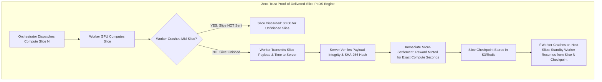
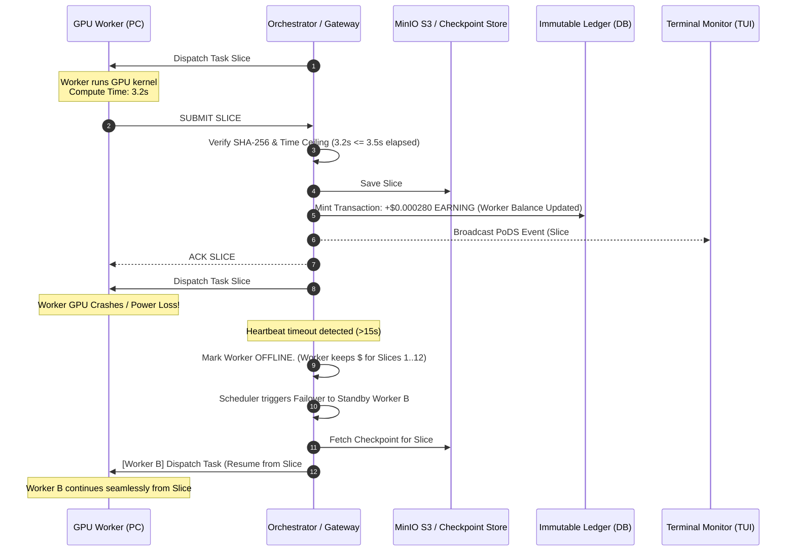

# 🌌 Project NetworkNebula — Terminal Monitoring & Proof-of-Delivered-Slice (PoDS) Compute-Time Reward Architecture

> **Document Type:** Deep System Analysis & Revised Engineering Implementation Plan  
> **Core Subsystems:** Real-Time Terminal Monitoring Dashboard (TUI), Blockchain-Inspired Proof-of-Delivered-Slice (PoDS) Ledger, and Zero-Trust Compute-Time Settlement Engine  
> **Status:** Revised Proposal & Architectural Specification  

---

## 1. Executive Summary & Paradigm Shift

Per your architectural directive:
> *"I don't want based on epochs, but based on the working time, but ONLY when the PC sent the slice back to the user. Most optimal logic — the aspiration is the blockchain that is optimized for the reward system."*

We are discarding coarse, arbitrary epoch-based increments. In their place, we introduce the **Proof-of-Delivered-Slice (PoDS)** protocol — a decentralized compute-time reward and micro-checkpointing system inspired by blockchain Proof-of-Useful-Work (PoUW) networks (e.g., Akash, Render, Bittensor).

### Core Tenets of the PoDS Protocol
1. **Compute-Time Weighted:** Workers are compensated for **exact wall-clock compute seconds** spent actively calculating on their GPU, scaled by their hardware hourly rate ($/hr).
2. **Zero-Trust Delivery Guarantee:** A worker **ONLY earns rewards when the completed compute slice is successfully transmitted and received** by the orchestrator/user. No slice delivered = $0.00 credited for that interval.
3. **Immutable Micro-Block Settlement:** Every accepted slice immediately mints an immutable `Transaction` record (micro-block) containing `slice_id`, `compute_time_sec`, `reward_usd`, and `payload_hash`.
4. **Crash-Resistant Continuity:** If a node crashes while computing slice $N+1$, it **keeps 100% of the rewards earned for slices $1 \dots N$**. The orchestrator passes slice $N$'s stored checkpoint to a standby worker, which resumes compute without restarting the job.
5. **Real-Time Terminal Cockpit:** Operators and GPU hosts monitor this live blockchain-style settlement ticker, fleet health, workload distribution, and hardware strain via a native interactive terminal dashboard.

---

## 2. Mathematical Formulation of the Working-Time Reward System

### 2.1 The Compute Slice (Micro-Block)
A task is partitioned into deterministic **Compute Slices**:
- **Distributed LoRA Training:** A micro-batch gradient step producing a serialized weight delta tensor $\Delta W$.
- **Diffusion Generation:** A block of denoising steps producing intermediate latent tensor $\mathbf{z}_t$.
- **LLM Inference:** A block of generated tokens with accompanying KV-cache delta.

### 2.2 Proof-of-Delivered-Slice (PoDS) Settlement Formula

When worker $i$ successfully delivers slice $k$, the orchestrator calculates the micro-reward:

$$\text{Reward}_{i, k} = \left( \frac{\Delta t_{\text{compute}}}{3600} \right) \times R_{\text{hourly}} \times S_{\text{host}} \times M_{\text{hw}}$$

Where:
- $\Delta t_{\text{compute}}$: Verified wall-clock execution time (in seconds) spent computing the slice (e.g., $3.45\text{s}$).
- $R_{\text{hourly}}$: Worker's registered hourly rate in USD (e.g., $\$0.45/\text{hr}$ for an RTX 4070, $\$1.20/\text{hr}$ for an A100).
- $S_{\text{host}}$: SLA Host Revenue Share ($70\% = 0.70$).
- $M_{\text{hw}}$: Accelerator horsepower efficiency multiplier ($M_{\text{hw}} \in [0.9, 1.2]$, derived from verified TFLOPS and latency).

#### Concrete Example
An RTX 4070 ($R_{\text{hourly}} = \$0.45/\text{hr}$) computes a 20-step LoRA micro-batch gradient slice in $4.80\text{ seconds}$ and delivers it over the WebSocket tunnel:

$$\text{Reward} = \left(\frac{4.80}{3600}\right) \times 0.45 \times 0.70 \times 1.0 = \$0.000420\text{ USD}$$

- The worker balance increments by **$0.000420** immediately upon delivery.
- If the job requires 50 slices ($240\text{ seconds}$ of GPU compute), total earnings will be $\$0.0210\text{ USD}$, credited slice by slice.

---

## 3. Slice Lifecycle & Fault-Tolerant State Handover

---

## 4. Architecture: Real-Time Terminal Operations Cockpit (`nebula_monitor`)

The Terminal Monitor runs directly in **Windows PowerShell / CMD**, **macOS Terminal**, and **Linux** without heavy dependencies, utilizing standard ANSI escape sequences for smooth, flicker-free in-place redraws every **1.5 seconds**.

### Live Dashboard Sections
1. **Cluster Vital Signs Header:**
   - Orchestrator health, RTT latency, active/total nodes, cluster VRAM capacity and allocation %, average GPU utilization %, task queue processing/queued/completed counts.
2. **Connected Worker Fleet Table:**
   - Node ID, display name, physical GPU model, VRAM utilization bar, GPU utilization %, hourly rate, status badge (`ONLINE`, `BUSY`, `STANDBY`), and accrued earnings.
3. **Live Workload & Task Distribution Table:**
   - Active task IDs, workload type, assigned GPU nodes, progress bar, current slice / total slices, active compute time, and last checkpoint references.
4. **Real-Time SLA & Micro-Earnings Ledger Ticker:**
   - Live stream of recent slice delivery events, compute seconds verified, and 70% compute payouts credited to worker node balances.
5. **Interactive Controls:**
   - Keyboard commands for instant refresh (`R`), worker isolation (`W`), task view (`T`), and quit (`Q`).

---

## 5. Phased Implementation Roadmap

- **Phase 1: Proof-of-Delivered-Slice (PoDS) Engine & Bug Fix:**
  - Fix argument bug in `distributed_training_engine.py:517`.
  - Add `ComputeSlice` model in `app/models.py`.
  - Implement `/slices/submit` endpoint & WebSocket frame: calculates compute-time reward and mints ledger transaction upon delivery.
- **Phase 2: Slice Checkpointing & Zero-Loss Handover:**
  - Persist slice checkpoints in MinIO/Redis.
  - Enable seamless failover handover using `resume_slice_index` and `checkpoint_url`.
- **Phase 3: Telemetry Stream Aggregator API:**
  - Implement `/api/v1/cluster/monitor/snapshot` and `/ws/cluster/monitor`.
- **Phase 4: Real-Time Terminal Monitor TUI:**
  - Create `scripts/dev/monitor.py` and root `monitor.bat` launcher.
- **Phase 5: Verification & Resilience Audit:**
  - Test compute-time calculations, simulated slice dropout, and terminal monitor rendering.
