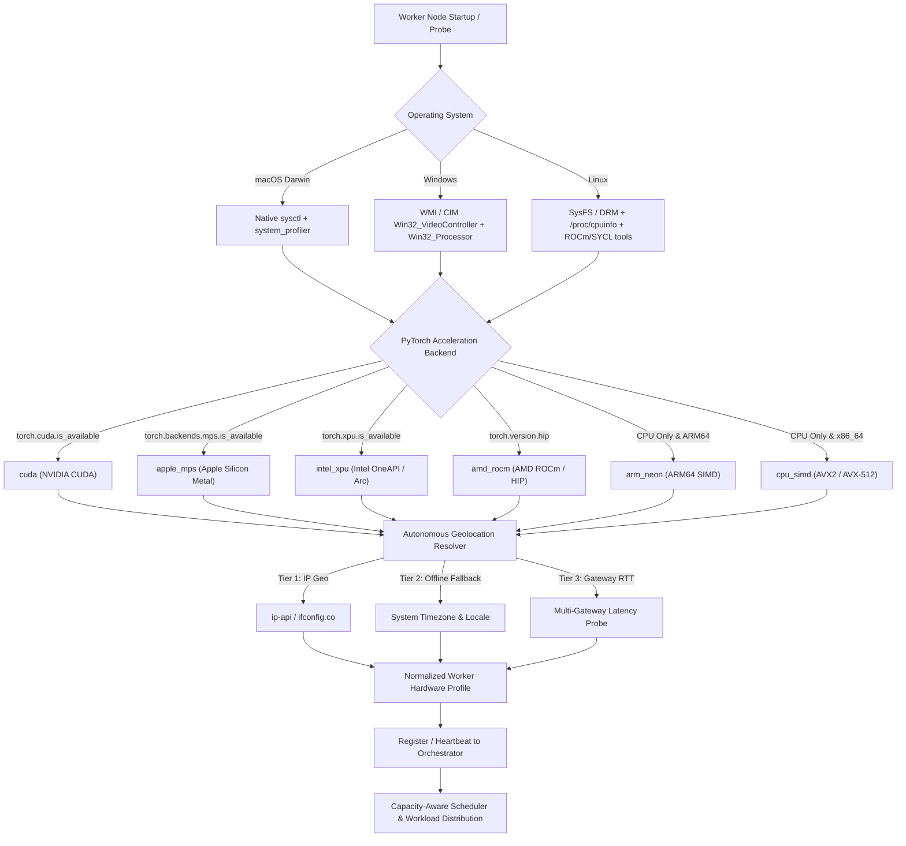

# Universal Hardware Introspection & Autonomous Geolocation System
## Production Architecture Plan & Testing Strategy

> [!IMPORTANT]
> **Problem Statement:** During multi-device testing on macOS (Apple Silicon M-series & Intel Mac) and contributor PCs (AMD, Intel Arc/Iris, ARM, NVIDIA, and CPU-only), the NetworkNebula fleet failed to recognize:
> 1. **Location:** Hardcoded fallback to `"us-east"`; no auto-detection of physical geography, country, or datacenter proximity.
> 2. **Hardware:** If CUDA is missing, nodes are misclassified as `"CPU Fallback Node"` with fabricated `8.0 GB` VRAM, ignoring actual Apple Unified Memory, Intel Arc discrete VRAM, or AMD Radeon cards.
> 3. **Compute Architecture (CUDA / Apple Silicon Metal / Intel Arc XPU / AMD ROCm / ARM NEON):** Binary reliance on `torch.cuda.is_available()` causes non-NVIDIA nodes to fail or be disqualified by the scheduler, even though they possess massive compute capability (e.g. M3 Max with 36–128GB Unified Memory or Intel Arc A770 with 16GB).

---

## 1. Root Cause Analysis

### 1.1 Location Recognition Failure
* **Current Flaw:** `worker/nebula_worker.py` and `app/cluster_worker_router.py` hardcode `region = "us-east"` with fixed latency.
* **Impact:** Workers connecting from Europe, Asia, or the Middle East are labeled `"us-east"`. Geographic data sovereignty constraints fail, and low-latency Ring All-Reduce clustering selects physically distant nodes, causing packet loss and slow training.
* **Resolution:** An autonomous **3-Tier Geolocation Engine**:
  1. *Tier 1 (Public IP Geo API):* Query lightweight, zero-dependency endpoints (`ip-api.com`, `ifconfig.co`, `ipinfo.io`) in parallel with a 1.5s timeout.
  2. *Tier 2 (System Timezone & Locale):* If offline or firewalled, resolve region via OS timezone (`time.tzname`, `zoneinfo`) into continental zones (`Americas` -> `us-east`/`us-west`, `Europe` -> `eu-central`, `Asia/Pacific` -> `ap-southeast`, `Middle East` -> `me-central`).
  3. *Tier 3 (Multi-Gateway RTT Triangulation):* Measure ping RTT against regional endpoints to pick the lowest latency hub.

### 1.2 Hardware & VRAM Recognition Failure
* **Current Flaw:** Single-point reliance on `torch.cuda.get_device_properties()`. When PyTorch is installed without CUDA or runs on macOS/Intel/AMD:
  - Total VRAM falls back to a hardcoded `8.0 GB` or is set to `0.0 GB`.
  - System RAM is confused with dedicated GPU memory.
  - Multi-core ARM (Apple M1/M2/M3/M4 or Ampere/Graviton) performance cores vs. efficiency cores are not inspected.
* **Resolution:** An OS-native hardware introspection pipeline:
  - **macOS:** Read `machdep.cpu.brand_string`, `hw.memsize`, `hw.ncpu` via `sysctl`, and parse `system_profiler SPDisplaysDataType -json` to extract GPU model, Apple Silicon GPU core counts, and exact Unified Memory headroom.
  - **Windows:** Query WMI / CIM (`Get-CimInstance Win32_VideoController`) to detect NVIDIA, Intel Arc/Xe, and AMD Radeon adapters with driver versions and dedicated video RAM (`AdapterRAM`).
  - **Linux:** Read `/sys/class/drm/card*/device/` and `/proc/cpuinfo`, complemented by `lspci` and `rocm-smi` / `clinfo` when available.

### 1.3 Acceleration Architecture & Runtime Failure
* **Current Flaw:** Binary flag `cuda_available: bool`. Non-CUDA compute is treated as generic CPU.
* **Resolution:** Introduce a standardized **Compute Architecture Taxonomy**:
  - `cuda`: NVIDIA CUDA + Tensor Cores (Ampere, Ada Lovelace, Hopper, Blackwell).
  - `apple_mps`: Apple Silicon Metal Performance Shaders (M1/M2/M3/M4 series with unified memory).
  - `intel_xpu`: Intel Arc, Data Center GPU Flex/Max, and Core Ultra NPUs via Intel OneAPI / SYCL (`torch.xpu`).
  - `amd_rocm`: AMD Radeon / Instinct via ROCm / HIP (`torch.version.hip`).
  - `arm_neon`: ARM64 CPU with NEON SIMD vector acceleration.
  - `cpu_simd`: x86_64 CPU with AVX-512 / AVX2 vector units.



---

## 2. Technical Architecture & Component Specifications

### 2.1 Autonomous Geolocation Engine (`app/geo_locator.py` & `worker/geo_locator.py`)
A lightweight, zero-external-dependency module with fallback tiers:

```python
class GeoLocationResult(BaseModel):
    region: str              # e.g., 'us-east', 'us-west', 'eu-central', 'ap-southeast', 'me-central'
    country: str             # e.g., 'United States', 'Germany', 'Israel', 'Japan'
    country_code: str        # e.g., 'US', 'DE', 'IL', 'JP'
    city: str                # e.g., 'New York', 'Frankfurt', 'Tel Aviv', 'Tokyo'
    public_ip: str           # Masked or full IP for routing
    timezone: str            # e.g., 'America/New_York', 'Europe/Berlin', 'Asia/Jerusalem'
    source: str              # 'public_api', 'timezone_fallback', or 'manual_override'
    latency_ping_ms: float   # Real round-trip ping to regional gateway
```

#### Regional Mapping Rules:
| Region Identifier | Geographic Coverage | Timezone / Country Signatures |
| :--- | :--- | :--- |
| `us-east` | US East Coast, Canada East | `America/New_York`, `EDT`, `EST`, `America/Toronto` |
| `us-west` | US West Coast, Canada West | `America/Los_Angeles`, `PDT`, `PST`, `America/Vancouver` |
| `eu-central` | Central & Western Europe, UK | `Europe/Berlin`, `Europe/Paris`, `Europe/London`, `CET`, `GMT` |
| `ap-southeast` | East Asia, Southeast Asia, Australia | `Asia/Tokyo`, `Asia/Singapore`, `Australia/Sydney`, `JST`, `SGT` |
| `me-central` | Middle East, Eastern Med | `Asia/Jerusalem`, `Asia/Dubai`, `Asia/Riyadh`, `IST+2` |
| `sa-east` | South America | `America/Sao_Paulo`, `America/Buenos_Aires`, `BRT` |

---

### 2.2 Universal Hardware Introspector (`app/hardware_detector.py`)
Inspects physical hardware across all platforms:

#### Data Structure:
```python
class HardwareProfile(BaseModel):
    hostname: str
    os_name: str                     # 'macOS 15.1 (Darwin)', 'Windows 11', 'Linux 6.8'
    cpu_model: str                   # 'Apple M3 Max', 'Intel Core i9-14900K', 'AMD Ryzen 9 7950X'
    cpu_architecture: str            # 'arm64', 'x86_64'
    cpu_physical_cores: int
    cpu_logical_cores: int
    memory_total_gb: float           # System RAM
    memory_available_gb: float       # Free headroom
    
    # GPU / Compute Accelerators
    gpu_model: str                   # e.g. 'Apple M3 Max (30-core GPU)', 'Intel Arc A770 (16GB)', 'NVIDIA RTX 4090'
    gpu_vendor: str                  # 'Apple', 'NVIDIA', 'Intel', 'AMD', 'ARM'
    compute_architecture: str        # 'cuda', 'apple_mps', 'intel_xpu', 'amd_rocm', 'arm_neon', 'cpu_simd'
    hardware_tier: str               # 'enterprise_gpu', 'consumer_gpu', 'apple_silicon', 'intel_arc', 'high_mem_cpu'
    is_unified_memory: bool          # True for Apple Silicon & APUs
    vram_total_gb: float             # Dedicated VRAM or accessible Unified Memory
    vram_used_gb: float
    vram_headroom_gb: float
    gpu_utilization_pct: float
    runtime_version: str             # e.g. 'Metal 3 / PyTorch 2.6.0', 'CUDA 12.8', 'OneAPI 2024.1'
    tensor_device_str: str           # 'cuda:0', 'mps', 'xpu:0', or 'cpu'
```

#### OS-Specific Introspection Logic:
1. **macOS:**
   - Detects M1/M2/M3/M4 Base/Pro/Max/Ultra.
   - Accurately reports Unified Memory instead of 0 or 8GB.
   - Maps Apple Silicon MPS as an accelerated tier capable of handling neural workloads.
2. **Windows:**
   - Uses `Get-CimInstance Win32_VideoController` to detect all cards: NVIDIA GeForce, Intel Arc, and AMD Radeon.
   - Extracts driver version, video architecture, and actual dedicated `AdapterRAM`.
3. **Linux:**
   - Checks `/sys/class/drm/` to detect PCI devices without relying on third-party CLIs.
   - Detects AMD ROCm (`/dev/kfd`) and Intel XPU (`/dev/dri/renderD*`).

---

### 2.3 Intelligent Workload Matching in Cluster Scheduler (`app/scheduler.py`)

The scheduler evaluates candidate nodes according to task requirements:

| Task Type | Minimum Hardware Requirements | Eligible Compute Architectures |
| :--- | :--- | :--- |
| **Distributed Training (Ring All-Reduce)** | High VRAM ($\ge 8\text{ GB}$), RTT $\le 15\text{ ms}$, homogeneous precision | `cuda`, `amd_rocm` |
| **LoRA Fine-Tuning** | Dedicated VRAM ($\ge 6\text{ GB}$) or Unified Memory ($\ge 16\text{ GB}$) | `cuda`, `apple_mps`, `amd_rocm` |
| **Neural Inference (SD 1.5, LLM)** | Any acceleration with $\ge 4\text{ GB}$ VRAM/Unified Memory | `cuda`, `apple_mps`, `intel_xpu`, `amd_rocm` |
| **Batch Inference** | Any acceleration or multi-core CPU ($\ge 8$ cores, $\ge 16\text{ GB}$ RAM) | `cuda`, `apple_mps`, `intel_xpu`, `amd_rocm`, `arm_neon`, `cpu_simd` |

> [!TIP]
> **Apple Silicon & Intel Arc Advantage:** For standard neural inference, an Apple M3/M4 with 36GB Unified Memory or an Intel Arc A770 with 16GB VRAM provides higher memory bandwidth and capacity than many entry-level NVIDIA cards at a fraction of the cost. The updated scheduler scores them favorably for inference and LoRA tuning tasks!

---

## 3. Database Schema Extensions

Extend the `Worker` model in [`app/models.py`](file:///c:/Users/ohadb/Desktop/ALL/APPS/Project NetworkNebula/app/models.py) with safe `ALTER TABLE` statements in [`app/main.py`](file:///c:/Users/ohadb/Desktop/ALL/APPS/Project NetworkNebula/app/main.py):

```sql
ALTER TABLE workers ADD COLUMN IF NOT EXISTS compute_architecture VARCHAR(32) DEFAULT 'cuda';
ALTER TABLE workers ADD COLUMN IF NOT EXISTS hardware_tier VARCHAR(32) DEFAULT 'consumer_gpu';
ALTER TABLE workers ADD COLUMN IF NOT EXISTS device_brand VARCHAR(100);
ALTER TABLE workers ADD COLUMN IF NOT EXISTS country VARCHAR(64);
ALTER TABLE workers ADD COLUMN IF NOT EXISTS city VARCHAR(100);
ALTER TABLE workers ADD COLUMN IF NOT EXISTS public_ip VARCHAR(64);
ALTER TABLE workers ADD COLUMN IF NOT EXISTS is_unified_memory BOOLEAN DEFAULT FALSE;
ALTER TABLE workers ADD COLUMN IF NOT EXISTS supported_task_types VARCHAR(255) DEFAULT 'inference,training';
```

---

## 4. Implementation Plan & Phases

### Phase 1: Shared Hardware & Geolocation Engines
* Create `app/hardware_detector.py` and `app/geo_locator.py` (and exportable for standalone workers in `worker/`).
* Support macOS native `sysctl` + `system_profiler`, Windows CIM/WMI, Linux DRM, and PyTorch multi-backend detection (`cuda`, `mps`, `xpu`, `hip`, `cpu`).
* Support 3-tier IP and timezone geolocation.

### Phase 2: Schema & Models
* Update `Worker` ORM model in `app/models.py`.
* Add idempotent DDL migrations in `app/main.py` startup event.

### Phase 3: Worker Client Registration & Heartbeat
* Update `worker/nebula_worker.py`:
  - `discover_hardware()` uses the new unified introspector.
  - Automatically resolves real location without requiring manual `--region`.
  - Sliced compute execution automatically dispatches to the optimal torch tensor device (`cuda`, `mps`, `xpu`, or `cpu`).
* Update `app/cluster_worker_router.py`:
  - Store rich hardware profile, architecture badges, and country/city upon worker join and heartbeat.

### Phase 4: Capacity-Aware Scheduler Upgrades
* Update `app/scheduler.py`:
  - Support `apple_mps` and `intel_xpu` in `score_worker_node`.
  - Respect sovereign geographic constraints matched against auto-detected regions.
  - Correctly evaluate Unified Memory headroom on Apple Silicon.

### Phase 5: Terminal Monitoring Cockpit Enhancements
* Update `scripts/dev/monitor.py` to display:
  - Architecture badge: `[APPLE M3 MAX 36GB MPS]`, `[INTEL ARC A770 16GB XPU]`, `[NVIDIA RTX 4070 12GB CUDA]`, `[ARM64 8-CORE NEON]`.
  - Real geolocation: e.g. `Frankfurt, DE [eu-central]`, `Tel Aviv, IL [me-central]`, `New York, US [us-east]`.

---

## 5. Testing & Verification Strategy

### 5.1 Multi-Architecture Unit & Emulation Tests
Since CI and developer machines may not have every physical GPU simultaneously, we write comprehensive mock/emulation test fixtures in `tests/test_suite.py`:
1. **Apple Silicon M-Series Simulation:**
   - Emulates `platform.system() == "Darwin"`, `machdep.cpu.brand_string = "Apple M3 Max"`, unified memory = 36GB, and PyTorch `mps` available.
   - Verifies hardware profile reports `compute_architecture = "apple_mps"`, `is_unified_memory = True`, and scheduler accepts it for inference and LoRA tuning.
2. **Intel Arc / SYCL Simulation:**
   - Emulates Windows/Linux with Intel Arc A770 (16GB VRAM) and `torch.xpu.is_available() = True`.
   - Verifies hardware profile reports `compute_architecture = "intel_xpu"`.
3. **AMD ROCm Simulation:**
   - Emulates Linux with AMD Radeon RX 7900 XTX and `torch.version.hip` active.
   - Verifies hardware profile reports `compute_architecture = "amd_rocm"`.
4. **ARM64 CPU Simulation:**
   - Emulates `platform.machine() == "arm64"`, physical cores = 8, no GPU.
   - Verifies hardware profile reports `compute_architecture = "arm_neon"`, `hardware_tier = "high_mem_cpu"`.

### 5.2 Geolocation & Offline Resilience Tests
1. **Live Geolocation Check:** Querying resolver returns valid country, city, and normalized cloud region string (`us-east`, `us-west`, `eu-central`, `me-central`, etc.).
2. **Air-Gapped / Offline Fallback:** When network requests to external IP geo APIs time out or fail, verify instant fallback to local timezone mapping (`time.tzname`) with 0 errors.

### 5.3 Execution & Timeout Safety
* All tests integrated into `tests/test_suite.py` with strict timeouts (`timeout=5` on network calls, `timeout=15` on subprocesses).
* Run `python tests/test_suite.py --quick` to ensure 100% pass rate with zero hanging or infinite loops.
